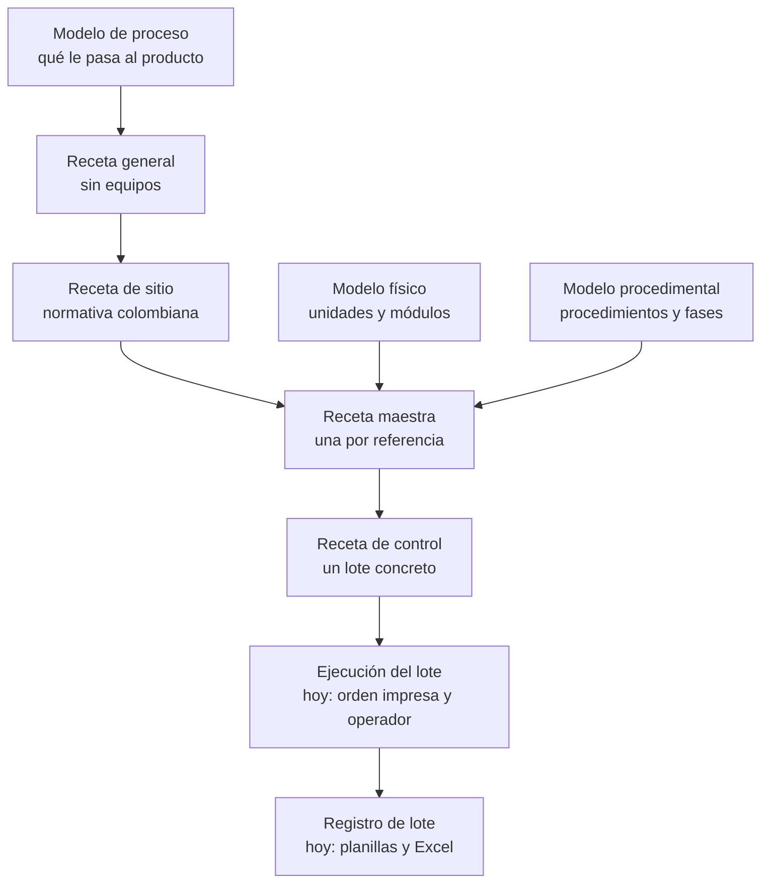

# ISA-88 · Producción por lotes

Modelo ISA-88 de la planta láctea de **Lácteos Altos de Teusacá** (empresa base, es decir, la planta como opera hoy, antes de la propuesta de automatización de Mekvra S.A.S).

**Responsables:** Luis Alberto Mendoza (líder de automatización) y Janan Libardo Carreño (líder de instrumentación y software).
**Línea desarrollada en detalle:** yogures (fresa, natural y griego). Quesos y leche UHT se modelan con el mismo método y con el detalle necesario para la planta completa.

## Documentos

| Documento | Pregunta que responde | Contenido |
|---|---|---|
| [`modelo-fisico/modelo-fisico.md`](modelo-fisico/modelo-fisico.md) | ¿Con qué produzco? | Empresa, sitio, áreas, celdas de proceso, unidades con su capacidad, módulos de equipo y módulos de control (tags de los P&ID) |
| [`modelo-procedimental/modelo-procedimental.md`](modelo-procedimental/modelo-procedimental.md) | ¿Qué acciones ejecuto? | Modelo de proceso, procedimientos de las tres líneas y del tronco común, operaciones y fases con sus parámetros, estados y modos, recursos compartidos |
| [`recetas/recetas.md`](recetas/recetas.md) | ¿Qué producto fabrico y con qué especificación? | Tipos de receta, las 9 recetas maestras (fórmula, equipos, procedimiento, especificación y PCC), lotes y trazabilidad |
| [`diagrama_tronco_comun.md`](diagrama_tronco_comun.md) | ¿Cómo se conectan las líneas? | Tronco común y las tres ramas de producto con sus unidades |

## Cómo encajan las piezas

En la empresa base la receta de control es una **orden de lote impresa** y su ejecución depende del operador y de los controladores locales de cada equipo. Pasar esa cadena a un MES y a fases ejecutadas por PLC es parte de la propuesta de automatización.

## Bases de diseño

| Dato | Valor |
|---|---|
| Leche recibida | 150.000 L/día (acta del 9 de octubre de 2026) |
| Días de producción | 6 por semana |
| Tamaño de lote | 10.000 L de leche estandarizada en las tres líneas |
| Lotes por semana | 91: 35 de yogures, 30 de quesos y 26 de leche UHT |
| Leche por línea | Yogures ≈ 58.300 L/día · quesos 50.000 L/día · leche UHT ≈ 43.300 L/día |
| Referencias | 9: tres por línea |
| Ampliación prevista | Contrato a un año para recibir 30.000 L/día más, destinados a yogures o quesos |

Los litros por día salen de los lotes por semana divididos entre 6 días. Por ejemplo, en yogures 35 × 10.000 L ÷ 6 ≈ 58.300 L/día. La suma de las tres líneas da ≈ 151.700 L/día; la diferencia de 1,1 % con los 150.000 L/día se acepta como variación normal del acopio.

Todas las cantidades son **valores de diseño** del grupo, tomados de la normativa colombiana, el Codex y la bibliografía técnica (Tetra Pak). La empresa es un caso de estudio y ninguna cifra es una medición de planta.

## Fuentes y criterio

**Documentos locales del proyecto (mandan cuando hay diferencias):**

- *Recetas y procesos de la planta* (11 de octubre de 2026). Fórmulas, procedimientos, parámetros, PCC, equipos y códigos de las tres líneas.
- *Diagramas P&ID de la empresa base* y su *documento explicativo* (11 de octubre de 2026). Instrumentos, válvulas, módulos y nivel de automatización de cada equipo.
- *Comunicación y visualización de los datos en la empresa base (ISA-95)* (11 de octubre de 2026). Qué se registra hoy, dónde y quién decide.
- *Diagramas de proceso de los nueve productos* (octubre de 2026).

**Carpeta de entregas del proyecto en Drive:** recetas de la línea de yogures v1.8, recetas básicas de la planta v1.0, VSM, layout y la presentación de la entrega intermedia. Se usan para datos que los documentos locales no tienen y que no los contradicen.

Los documentos anteriores de esta carpeta ([`recetas/recetas_linea_yogures.md`](recetas/recetas_linea_yogures.md) y los PDF de las recetas v1.7, v1.8 y v1.0) se conservan como historial y detalle de la línea de yogures. Donde haya diferencias, manda este modelo, que sigue el documento *Recetas y procesos de la planta*. La principal: en la empresa base el **paletizado es manual**; la celda robotizada es parte de la propuesta.

## Norma de referencia

ANSI/ISA-88.00.01 (IEC 61512-1), *Batch Control Part 1: Models and Terminology*. Los símbolos y las letras de los instrumentos siguen ANSI/ISA-5.1.
