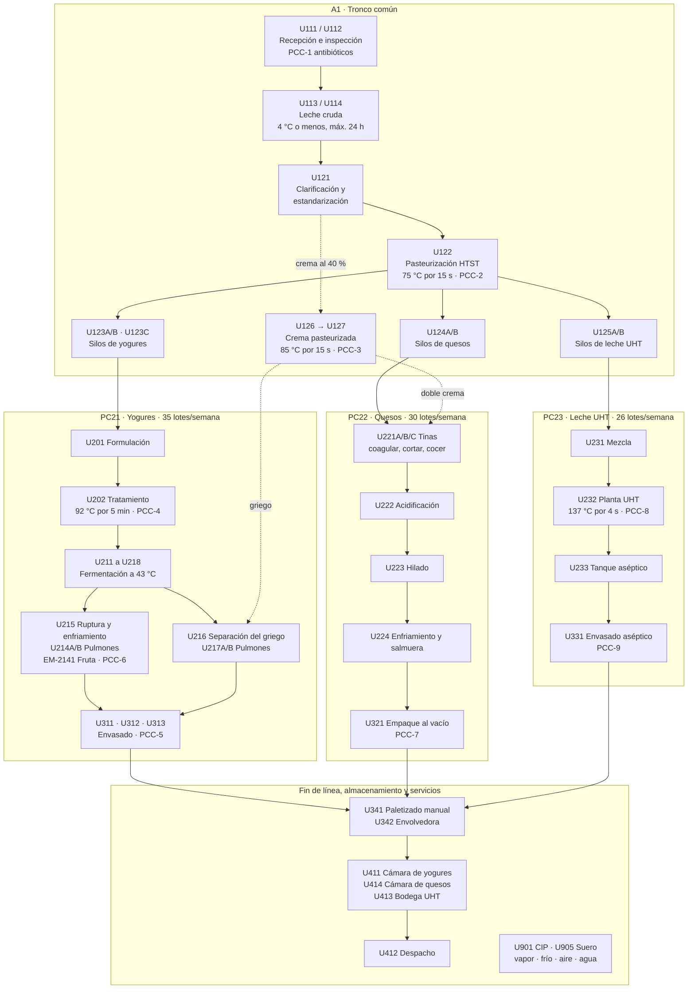

# Tronco común y líneas de producto (ISA-88)

La planta arranca con un **tronco común** que recibe los 150.000 L/día de leche, la estandariza y la pasteuriza en continuo, y la deja en silos separados por línea. Cada línea toma un lote de leche base liberado de su silo, así que la trazabilidad queda encadenada desde la cisterna hasta el producto terminado.

| Línea | Productos | Silos | Leche por día |
|---|---|---|---|
| Yogures | Fresa, natural y griego | U123A/B (3,50 %) y U123C (0,05 % o menos) | ≈ 58.300 L |
| Quesos | Mozzarella, quesillo y doble crema | U124A/B (3,0, 3,2 o 3,6 %) | 50.000 L |
| Leche UHT | Entera, descremada y con chocolate | U125A (3,0 %) y U125B (0,3 %) | ≈ 43.300 L |

Los silos A y B de cada línea trabajan en alternancia: uno se llena con la grasa del siguiente producto mientras el otro alimenta la línea. Códigos ISA-88: A = área, PC = celda de proceso, U = unidad, EM = módulo de equipo. El detalle de cada nivel está en el [modelo físico](modelo-fisico/modelo-fisico.md).
