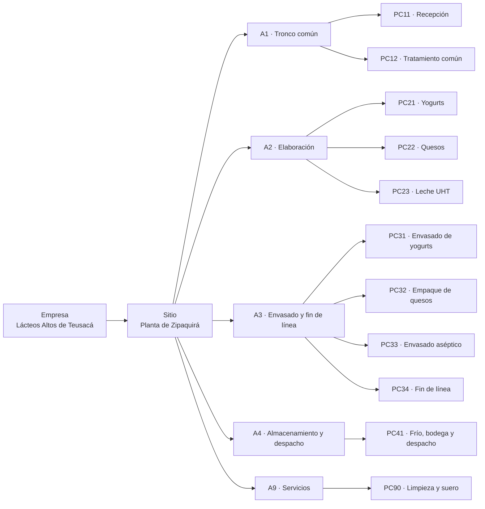
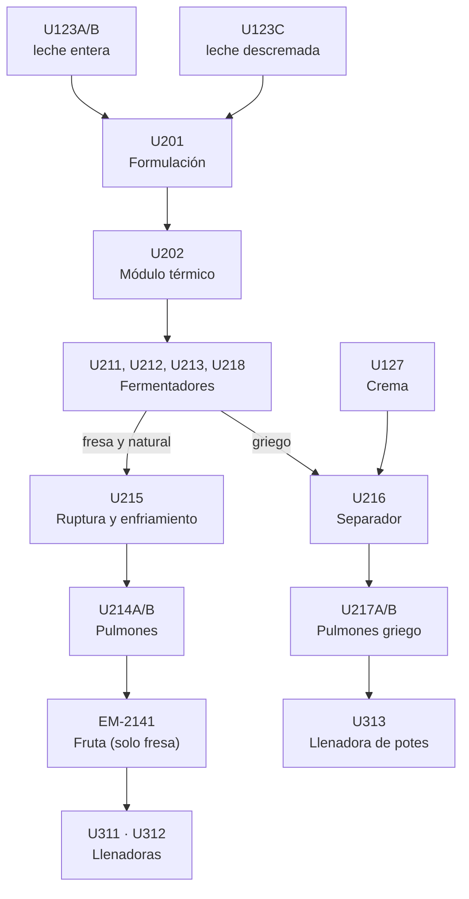

# Modelo físico ISA-88

| Nivel ISA-88 | Qué es | En la planta |
|---|---|---|
| Empresa | La organización dueña de la planta | Lácteos Altos de Teusacá |
| Sitio | La planta física | Planta de Zipaquirá, 150.000 L/día |
| Área | Zona de la planta con una función | A1 tronco común, A2 elaboración, A3 envasado y fin de línea, A4 almacenamiento y despacho, A9 servicios |
| Celda de proceso | Grupo de unidades que trabajan juntas para hacer un lote | Por ejemplo, PC21 línea de yogurts |
| Unidad | Equipo donde ocurre una actividad sobre el lote | Por ejemplo, U211 primer fermentador |
| Módulo de equipo | Grupo de dispositivos que cumple una función dentro de una unidad | Por ejemplo, el control térmico de la camisa del fermentador |
| Módulo de control | Instrumento, válvula, motor o lazo individual | Por ejemplo, el lazo TIC-2111 con su válvula TCV-2111 |

Este modelo describe la **empresa base**. Los equipos, capacidades y tags son los de las recetas y los P&ID del proyecto.

## Convenciones

**Código de los equipos.** `U` + área + celda + número. Por ejemplo, **U211** es el área 2, la celda 1 (yogurts) y la unidad 1, el primer fermentador. Las letras A, B y C distinguen equipos iguales (U123A, U221C). El mismo código se usa en las recetas, los P&ID, el documento ISA-95 y el modelo de Tecnomatix.

**Otros prefijos de los P&ID.** `E` intercambiador, `P` bomba, `H` homogeneizador, `M` motor de agitador, `EM` módulo de equipo con nombre propio en el P&ID.

**Tags de instrumentos (ANSI/ISA-5.1).** La primera letra es la variable y las siguientes la función. `T` temperatura, `P` presión, `L` nivel, `F` caudal, `W` peso, `S` velocidad, `A` análisis, `X` detector de metales, `H` mando manual. `I` indica, `T` transmite, `C` controla, `R` registra, `S` interruptor, `V` válvula. `TM` es una toma de muestra manual. El número repite el de la unidad: TIC-2111 es el controlador de temperatura de U211.

**Modo de operación de cada unidad.** B por lotes (batch), C continuo y D discreto.

**Dónde se ve cada módulo de control.** Es lo que muestra el nivel de automatización de la planta, y sale del símbolo del P&ID:

| Símbolo | Significado |
|---|---|
| Círculo simple | En campo: se lee en el mismo equipo |
| Círculo con una línea | En el SCADA de la sala de control (solo tronco común y CIP) |
| Círculo con doble línea | En el panel local del equipo o en un controlador autónomo |
| Rombo en un cuadro | PLC: con línea simple el PLC-100 del tronco común; con doble línea el PLC propio de una máquina (fabricante) |

## Vista general

Las celdas de A1 y A2 son las del documento de los P&ID. Las de A3, A4 y A9 salen directamente del código de sus unidades (U311 es área 3, celda 1).

## Área A1 · Tronco común

Es compartida por las tres líneas. Recibe toda la leche, la estandariza y la pasteuriza en flujo continuo, y la deja en un silo por línea. Es la única parte de la planta con PLC central (PLC-100) y SCADA con historiador.

### Celda PC11 · Recepción

| Unidad | Equipo | Capacidad | Modo |
|---|---|---|---|
| U111, U112 | Bahías de descarga con desaireador, filtro dúplex, caudalímetro y enfriador de placas | 30 a 40 m³/h cada una; unas 8 cisternas de 20.000 L por día | D/C |
| U113, U114 | Tanques de leche cruda aislados, con agitador | 2 × 60.000 L, a 4 °C o menos, máximo 24 h | B |

| Unidad | Módulo de equipo | Módulos de control | Dónde se ve |
|---|---|---|---|
| U111/U112 | Descarga | HV-1101 válvula de entrada · desaireador con LSL-1101 (nivel bajo, protege la bomba) · filtro dúplex con PDI-1102 · P-1101 bomba con HS-1101 (marcha desde panel) | Campo y panel; LSL al PLC-100 |
| U111/U112 | Medición de lo recibido | FQI-1101 caudal totalizado · TI-1101 temperatura de llegada | SCADA e historiador |
| U111/U112 | Enfriamiento | E-1101 enfriador de placas · TT-1102 · TIC-1102 (lazo del PLC-100) · TCV-1102 agua helada o glicol | SCADA |
| U113, U114 | Almacenamiento | HV-1131/HV-1141 entrada · agitador M · LI-1131/LI-1141 nivel · TI-1131/TI-1141 temperatura · LSHH-1131/LSHH-1141 nivel muy alto (detiene la bomba) · HV-1132/HV-1142 salida | SCADA |
| U113, U114 | Transferencia a tratamiento | P-1132 con HS-1132 | Panel |

La bahía U112 tiene la misma instrumentación que U111. La aprobación de la cisterna (PCC-1, antibióticos) la hace el laboratorio y es manual: el operador abre HV-1101 cuando el laboratorio le avisa.

### Celda PC12 · Tratamiento común

| Unidad | Equipo | Capacidad | Modo |
|---|---|---|---|
| U121 | Separadora-clarificadora con estandarización de grasa | 20.000 L/h, a 55 °C (50 a 60 °C) | C |
| U122 | Pasteurizador HTST de placas con regeneración, tubo de retención y válvula de desvío | 20.000 L/h, 75 °C por 15 s | C |
| U123A, U123B | Silos de leche entera para yogurt, en alternancia | 2 × 40.000 L, grasa 3,50 % | B |
| U123C | Silo de leche descremada para griego | 25.000 L, grasa 0,05 % o menos | B |
| U124A, U124B | Silos de leche para quesos, en alternancia | 2 × 25.000 L, grasa 3,0, 3,2 o 3,6 % según el queso | B |
| U125A | Silo de leche UHT entera y base del chocolate | 25.000 L, grasa 3,0 % | B |
| U125B | Silo de leche UHT descremada | 25.000 L, grasa 0,3 % | B |
| U126 | Pasteurizador de crema (paquete del fabricante) | 85 °C por 15 s | C |
| U127 | Tanque de crema pasteurizada | 1.000 L, a 4 °C o menos, máximo 24 h | B |

| Unidad | Módulo de equipo | Módulos de control | Dónde se ve |
|---|---|---|---|
| U122 | Alimentación a caudal constante | Tanque de balance con LT-1217 · P-1214 bomba de tiempo con variador · FT-1214 caudal | PLC del fabricante |
| U122 | Regeneración | Sección de placas · PDT-1213 presión diferencial (lado pasteurizado 0,3 bar por encima del crudo) | PLC del fabricante |
| U121 | Separación y estandarización | Separadora con SI-1201 velocidad y TI-1201 temperatura · crema por FI-1202 (rotámetro) y HV-1202 (manual) · TM-1202 muestra de grasa | Pantalla de U121; grasa en laboratorio |
| U122 | Calentamiento y retención | TCV-1211 agua caliente · TT-1211 · tubo de retención de 15 s · TT-1212 · TRC-1212 registrador · FDV-1212 desvío si la temperatura baja de 72 °C (PCC-2) | PLC del fabricante; lectura por Ethernet al SCADA e historiador |
| U122 | Enfriamiento | TCV-1215 agua helada · TT-1215 | PLC del fabricante |
| U123 a U125 | Almacenamiento por silo | HV-1231A/B/C, HV-1241A/B, HV-1251A/B entrada · agitador M · LI y TI de cada silo (LI-1231A … LI-1251B, TI-1231A … TI-1251B) | SCADA con alarmas |
| U126 | Pasteurización de crema | TCV-1261 agua caliente · TT-1262 · TRC-1262 · FDV-1262 desvío si baja de 80 °C (PCC-3) | PLC del fabricante; lectura al SCADA |
| U127 | Almacenamiento de crema | Agitador M · TT-1271 · TIC-1271 (lazo del PLC-100) · TCV-1271 glicol · LI-1271 · HV-1272 salida a U216 o a las tinas | SCADA |

La estandarización de la grasa es manual: el operador ajusta HV-1202 mirando FI-1202 y la confirma con la muestra TM-1202. Cada silo se libera con fosfatasa negativa y peroxidasa positiva antes de transferir a su línea.

## Área A2 · Elaboración

### Celda PC21 · Yogurts (línea desarrollada en detalle)

| Unidad | Equipo | Capacidad | Modo |
|---|---|---|---|
| U201 | Tanque de formulación con mezclador de polvos al vacío, báscula y calentamiento en línea | 12.000 L; carga calentada de 4 a 50 °C | B |
| U202 | Módulo térmico: regeneración, desaireador, homogeneizador de dos etapas, retención de 5 min y enfriador (paquete del fabricante) | 10 m³/h, hasta 250 bar | C |
| U211, U212, U213, U218 | Fermentadores aislados con camisa y agitador lento | 4 × 12.000 L, a 43 °C | B |
| U215 | Bomba de lóbulos, texturizador y enfriador de placas de canal ancho | 10 m³/h, salida a 20 °C | C |
| U214A, U214B | Tanques pulmón para fresa (A) y natural (B), con venteo estéril | 2 × 12.000 L, 18 a 22 °C | B |
| U216 | Separador centrífugo de boquillas con enfriador tubular (paquete del fabricante) | 7.000 L/h | C |
| U217A, U217B | Pulmones del griego con agitador de ancla, un lote por pulmón | 2 × 4.000 L, 12 °C o menos | B |

**Módulos de equipo y de control de la línea de yogurts**

Los módulos de equipo que tienen nombre en el P&ID se escriben con su código (EM-2012, EM-2014, EM-2141). Los demás se nombran por su función.

| Unidad | Módulo de equipo | Módulos de control | Dónde se ve |
|---|---|---|---|
| U201 | Carga de leche | HV-2011A (desde U123A/B) · HV-2011B (desde U123C) · P-2011 bomba con HS-2011 · FQI-2011 cantidad cargada | Panel local |
| U201 | EM-2014 Calentamiento en línea | TT-2011 · TIC-2011 · TCV-2011 agua caliente (de 4 a 50 °C) | Panel local |
| U201 | EM-2012 Mezclador de polvos al vacío | WI-2012 báscula de piso (pesa el operador) · HV-2012 leche en polvo · HV-2013 azúcar (solo fresa) · HV-2016 · P-2015 recirculación con HV-2015 | Panel local |
| U201 | Agitación y nivel | Agitador M de alta cizalla · LI-2011 · LSHH-2011 nivel muy alto · HV-2017 salida a U202 | Panel local |
| U202 | Regeneración y desaireación | E-2021 · TI-2021 · desaireador con PI-2027 (vacío) | PLC del fabricante |
| U202 | Homogeneización | H-2021 dos etapas, 200 + 50 bar · P-2022 · PI-2021 y PI-2022 · HV-2023 derivación para el griego | PLC del fabricante |
| U202 | Tratamiento térmico | E-2022 · TCV-2023 · TT-2023 · celda de retención de 5 min · TT-2024 · TRC-2024 · FDV-2024 desvío si baja de 90 °C (PCC-4) | PLC del fabricante; registro impreso |
| U202 | Enfriamiento a inoculación | E-2026 · TT-2026 · TCV-2026 agua helada (a 43 °C) | PLC del fabricante |
| U211 (igual en U212, U213 y U218) | Control térmico de la camisa | TT-2111 · TIC-2111 controlador autónomo · TCV-2111 agua caliente | Panel local (display del TIC) |
| U211 | Enfriamiento para cortar | HV-2113 agua helada, la abre el operador | Manual |
| U211 | Agitación | Agitador M | Panel local |
| U211 | Medición del lote | LI-2111 nivel · TM-2111 toma de muestra de pH | Panel; pH en planilla |
| U211 | Entrada y salida | HV-2111 entrada desde el cabezal · HV-2112 salida a U215 o a U216 | Manual |
| U215 | Ruptura y enfriamiento | P-2151 bomba de lóbulos · texturizador · enfriador de canal ancho · TT-2151 · TIC-2151 · TCV-2151 agua helada | Panel local |
| U214A/B | Pulmón | HV-2141A/B entrada · venteo estéril · LI-2141A/B · TI-2141A/B · HV-2142A/B salida · P-2142 | Indicadores en campo |
| U214A | EM-2141 Dosificador de fruta (solo fresa) | Bolsa aséptica a 8 °C o menos · P-2143 · HIC-2143 velocidad fija que pone el operador · mezclador estático · HV-2144 y HV-2145 (cerradas en natural) | Panel local; PCC-6 |
| U216 | Separación del griego | P-2161 bomba de lóbulos · separador de boquillas · TM-2161 muestra de proteína · suero ácido a U905 | PLC del fabricante |
| U216 | Enfriamiento del concentrado | E-2162 enfriador tubular · TT-2162 · TIC-2162 · TCV-2162 agua helada (10 a 12 °C) | Panel local |
| U216 | Restitución de grasa | Crema desde U127 · P-2163 · HIC-2163 velocidad fija · HV-2163 · mezclador | Panel local; PCC-3 aguas arriba |
| U217A/B | Pulmón del griego | HV-2171A/B entrada · agitador de ancla M · LI-2171A/B · TI-2171A/B · HV-2172A/B salida a U313 | Indicadores en campo |

### Celda PC22 · Quesos

| Unidad | Equipo | Capacidad | Modo |
|---|---|---|---|
| E-2210 | Atemperador de placas a la entrada de la línea | Leche a 32 a 35 °C | C |
| U221A, U221B, U221C | Tinas queseras de doble pared con liras | 3 × 10.000 L; 3,0 h por lote más 0,5 h de lavado | B |
| U222 | Banda de drenaje y acidificación de la cuajada | Unos 1.300 kg de cuajada, a 35 a 38 °C | B |
| U223 | Hiladora-moldeadora de tornillos | 1.000 a 1.300 kg/h | C |
| U224 | Canal de enfriamiento y piscinas de salmuera | Un día de producción; salmuera al 20 % a 8 a 12 °C | B |

| Unidad | Módulo de equipo | Módulos de control | Dónde se ve |
|---|---|---|---|
| E-2210 | Atemperado | P-2210 con HS-2210 · TT-2210 · TIC-2210 · TCV-2210 agua caliente | Panel local |
| U221 (cabezal) | Crema para doble crema | HV-2212 · FQI-2212 contador (160 L por lote) | Panel local |
| U221A (igual en B y C) | Control térmico de la camisa | TT-2211A · TIC-2211A · TCV-2211A agua caliente | Panel local |
| U221A | Corte y agitación | Liras con motor M y variador SIC-2211A | Panel local |
| U221A | Medición y desuerado | TM-2211A muestra de pH · HV-2211A entrada · HV-2214A suero dulce a U905 · HV-2215A cuajada · P-2216 bomba de cuajada | Manual |
| U222 | Acidificación | TI-2221 · TM-2221 muestra de pH (el operador decide cuándo pasa a hilar) | Campo; pH en planilla |
| U223 | Hilado | TT-2231 · TIC-2231 · TCV-2231 agua de hilado (75 a 85 °C) · TI-2233 temperatura de la pasta · WI-2232 báscula de sal (quesillo y doble crema) | Panel local |
| U224 | Canal de enfriamiento | TT-2242 · TIC-2242 · TCV-2242 agua helada (4 a 10 °C) | Panel local |
| U224 | Salmuera | TI-2241 · LI-2241 · TM-2241 muestra de NaCl · P-2241 recirculación con filtro · E-2244 enfriador · TT-2244 · TIC-2244 · TCV-2244 glicol | Panel local; PC-Q por turno |

### Celda PC23 · Leche UHT

| Unidad | Equipo | Capacidad | Modo |
|---|---|---|---|
| U231 | Tanque de mezcla con tolva y mezclador de alto cizallamiento (EM-2313) | 12.000 L | B |
| U232 | Planta UHT indirecta (placas y tubos) con homogeneizador aséptico (paquete del fabricante) | 10.000 L/h, 137 °C por 4 s | C |
| U233 | Tanque aséptico con aire estéril | 20.000 L | C |

| Unidad | Módulo de equipo | Módulos de control | Dónde se ve |
|---|---|---|---|
| U231 | Carga de leche | HV-2311A (desde U125A) · HV-2311B (desde U125B) | Manual |
| U231 | Calentamiento y nivel | TT-2311 · TIC-2311 · TCV-2311 agua caliente (chocolate a 60 a 65 °C) · LI-2311 · LSHH-2311 · agitador M con HS-2311 | Panel local |
| U231 | EM-2313 Incorporación de sólidos | WI-2312 báscula de piso · tolva de azúcar, cacao y carragenina · mezclador de alto cizallamiento · P-2314 · HV-2315 recirculación · HV-2314 y HV-2316 salida a U232 | Panel local |
| U232 | Precalentamiento y desaireación | Tanque de balance con LT-2321 · P-2321 · E-2321 regeneración · desaireador con PI-2327 · P-2322 | PLC del fabricante |
| U232 | Esterilización | E-2322 calentamiento · TCV-2323 agua presurizada · retención de 4 s · TT-2324 · TRC-2324 · FDV-2324 desvío si baja de 137 °C (PCC-8) | PLC del fabricante; registro impreso |
| U232 | Homogeneización aséptica y enfriamiento | E-2325 preenfriamiento a unos 70 °C · H-2321 200/50 bar · PI-2321 y PI-2322 · E-2326 · TT-2326 · TCV-2326 agua helada (20 a 25 °C) | PLC del fabricante |
| U233 | Almacenamiento estéril | PI-2331 presión de aire estéril · LI-2331 | PLC del fabricante |

## Área A3 · Envasado y fin de línea

| Celda | Unidad | Equipo | Capacidad | Modo |
|---|---|---|---|---|
| PC31 | U311 | Llenadora-selladora de vasos preformados | 12.000 vasos/h de 150 g; 10.000/h de 200 g | D |
| PC31 | U312 | Llenadora-taponadora de botellas con sello de inducción | 4.000/h de 1000 g; 2.500/h de 1750 g | D |
| PC31 | U313 | Llenadora de potes con dosificador de pistón | 6.000/h de 150 g; 2.400/h de 500 g | D |
| PC32 | U321 | Empacadora al vacío (termoformadora) de quesos | Unos 1.100 kg/h | D |
| PC33 | U331 | Envasadora aséptica de cajas de 1 L | Unos 7.000 envases/h | D |
| PC34 | U341 | Paletizado manual | 2 operarios por línea | D |
| PC34 | U342 | Envolvedora de estibas | — | D |

| Unidad | Módulo de equipo | Módulos de control | Dónde se ve |
|---|---|---|---|
| U311 (igual en U312 y U313) | Inspección antes de llenar | XS-3113 detector de metales en tubería (XS-3123 en U312, XS-3133 en U313), con alarma y parada (PCC-5) · HV-3110 entrada (HV-3120 en U312) | Pantalla de la llenadora |
| U311 | Llenado, sellado y control de peso | PLC del fabricante · TIC-3111 temperatura de la mordaza · WI-3111 peso (TIC-3121 y WI-3121 en U312; TIC-3131 y WI-3131 en U313) | Pantalla de la llenadora; contador copiado al final del turno |
| U321 | Inspección y empaque | XS-3213 detector de metales antes de la empacadora (PCC-7) · PLC del fabricante · PI-3211 vacío | Pantalla de la máquina |
| U331 | Esterilización del envase y llenado | PLC del fabricante · TIC-3311 temperatura del baño de H₂O₂ · AI-3312 concentración de H₂O₂ (PCC-9) · WI-3313 peso | Panel de U331 |

## Área A4 · Almacenamiento y despacho (celda PC41)

| Unidad | Equipo | Condición | Módulos de control | Modo |
|---|---|---|---|---|
| U411 | Cámara fría de yogurts | 2 a 4 °C, reposo de 12 h como mínimo | TIC-4111 · TR-4111 registrador | B |
| U412 | Muelle de despacho | Camión refrigerado de 2 a 6 °C (yogurts y quesos); camión seco (UHT) | — | D |
| U413 | Bodega de leche UHT | Temperatura ambiente, lote retenido hasta su liberación | — | B |
| U414 | Cámara fría de quesos | 2 a 4 °C, reposo de 12 h | TIC-4141 · TR-4141 registrador | B |

Los registradores de las cámaras se descargan cada semana; no hay monitoreo en línea.

## Área A9 · Servicios (celda PC90)

| Unidad | Equipo | Módulos de control | Dónde se ve |
|---|---|---|---|
| U901 | Estación CIP central con cuatro tanques: agua recuperada (T1), soda NaOH 0,5 a 2 % (T2), ácido HNO₃ 0,5 a 1,5 % (T3) y agua de enjuague a 90 a 95 °C (T4) | LI-9011 a LI-9014 · TI-9012 a TI-9014 · TM-9012 y TM-9013 titulación manual · XV-9011A/B a XV-9014A/B · HV-9018 agua de red · P-9011 impulsión · E-9011 calentador con TCV-9014 (vapor) y TT-9015 · P-9012 retorno con TI-9011 · panel de conexiones con codos | PLC del fabricante; el SCADA del tronco lee el programa y TT-9015 |
| U905 | Manejo de suero (dulce de quesos y ácido del griego) | — | — |

Además, la planta tiene servicios de vapor, frío (NH₃ y glicol), aire comprimido, tratamiento de agua y PTAR, que aparecen en los diagramas de proceso como servicios compartidos.

## Resumen del nivel de automatización por unidad

| Tipo de control | Unidades |
|---|---|
| PLC-100 y SCADA con historiador | U111 a U114, silos U123 a U125, U127 |
| PLC del fabricante con lectura al SCADA | U122, U126, U901 |
| PLC del fabricante sin red | U121, U202, U216, U232, U233, U311 a U313, U321, U331 |
| Controladores autónomos en panel local | U201, fermentadores U211 a U218, U215, enfriador de U216, E-2210, tinas U221, hiladora U223, U224, U231, cámaras U411 y U414 |
| Manual | Aprobación de la cisterna, estandarización de grasa, corte de la fermentación, pH de hilado, dosificación de fruta y crema, paletizado |

Fuentes: *Diagramas P&ID de la empresa base* y su documento explicativo, *Recetas y procesos de la planta* (sección de equipos y códigos) y *Comunicación y visualización de los datos en la empresa base (ISA-95)*.
