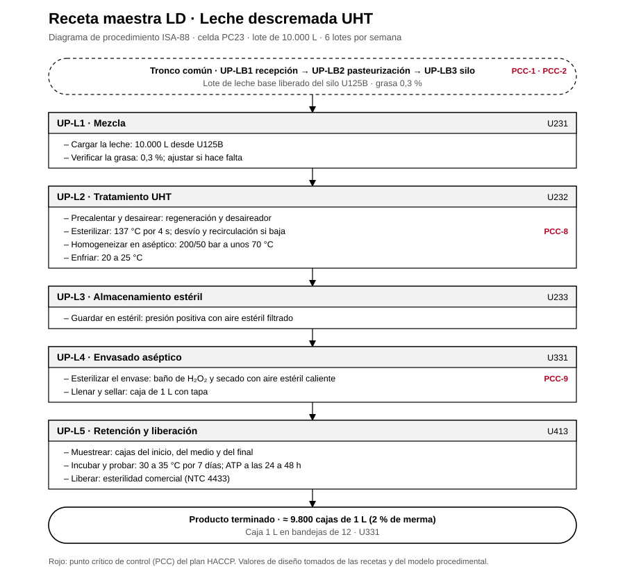

# Receta maestra LD · Leche descremada UHT

Receta maestra ISA-88 de la referencia LD, ligada a la celda PC23 y a sus unidades. Sale del [modelo físico](../modelo-fisico/modelo-fisico.md), el [modelo procedimental](../modelo-procedimental/modelo-procedimental.md) y las [recetas de la planta](../Recetas_y_procesos_planta.pdf).

## 1. Encabezado

| Campo | Valor |
|---|---|
| Código | LD |
| Producto | Leche descremada UHT |
| Denominación | Leche descremada de larga vida, esterilizada UAT y envasada en aséptico |
| Línea · celda | Leche UHT · PC23 |
| Tamaño del lote | 10.000 L de leche estandarizada |
| Lotes por semana | 6 |
| Orden de producción | Segunda del día |
| Leche base | Silo U125B, grasa 0,3 % |
| Producto por lote | ≈ 9.800 cajas de 1 L (2 % de merma) |
| Presentaciones | Caja 1 L en bandejas de 12 · U331 |
| Vida útil | 6 meses sin frío, sin abrir |

## 2. Fórmula por lote

| Materia prima o corriente | Cantidad |
|---|---|
| Leche pasteurizada (U125B) al 0,3 % | 10.000 L |
| Crema sobrante de la estandarización | sale de U121 a U126 |
| **Producto** | **≈ 9.800 cajas de 1 L (2 % de merma)** |

## 3. Requerimientos de equipo

U231, U232, U233, U331, U413.

## 4. Procedimiento

Procedimientos de unidad en orden, con sus fases y los valores de esta receta. Antes del primero, el tronco común entrega un lote de leche base liberado (UP-LB1 recepción, UP-LB2 pasteurización a 75 °C por 15 s y UP-LB3 almacenamiento en U125B).

| Procedimiento de unidad | Unidad | Fase | Valor de receta | PCC |
|---|---|---|---|---|
| UP-L1 Mezcla | U231 | Cargar la leche | 10.000 L desde U125B |  |
|  |  | Verificar la grasa | 0,3 %; ajustar si hace falta |  |
| UP-L2 Tratamiento UHT | U232 | Precalentar y desairear | regeneración y desaireador |  |
|  |  | Esterilizar | 137 °C por 4 s; desvío y recirculación si baja | PCC-8 |
|  |  | Homogeneizar en aséptico | 200/50 bar a unos 70 °C |  |
|  |  | Enfriar | 20 a 25 °C |  |
| UP-L3 Almacenamiento estéril | U233 | Guardar en estéril | presión positiva con aire estéril filtrado |  |
| UP-L4 Envasado aséptico | U331 | Esterilizar el envase | baño de H₂O₂ y secado con aire estéril caliente | PCC-9 |
|  |  | Llenar y sellar | caja de 1 L con tapa |  |
| UP-L5 Retención y liberación | U413 | Muestrear | cajas del inicio, del medio y del final |  |
|  |  | Incubar y probar | 30 a 35 °C por 7 días; ATP a las 24 a 48 h |  |
|  |  | Liberar | esterilidad comercial (NTC 4433) |  |

## 5. Especificación del producto terminado

- Grasa 0,1 a 0,5 % m/v
- Acidez 0,13 a 0,17 %
- Fosfatasa y peroxidasa negativas
- Esterilidad comercial (NTC 4433)
- Peróxido residual en el envase ≤ 0,5 ppm
- Vida útil: 6 meses sin frío, sin abrir

## 6. Puntos críticos de control

| Código | Control |
|---|---|
| PCC-1 | Antibióticos en cada cisterna (recepción) |
| PCC-2 | Pasteurización de la leche a 75 °C por 15 s |
| PCC-8 | Esterilización UHT a 137 °C por 4 s |
| PCC-9 | Esterilización del envase con H₂O₂ (envasado aséptico) |

Valores de diseño del proyecto; no son mediciones de planta.
