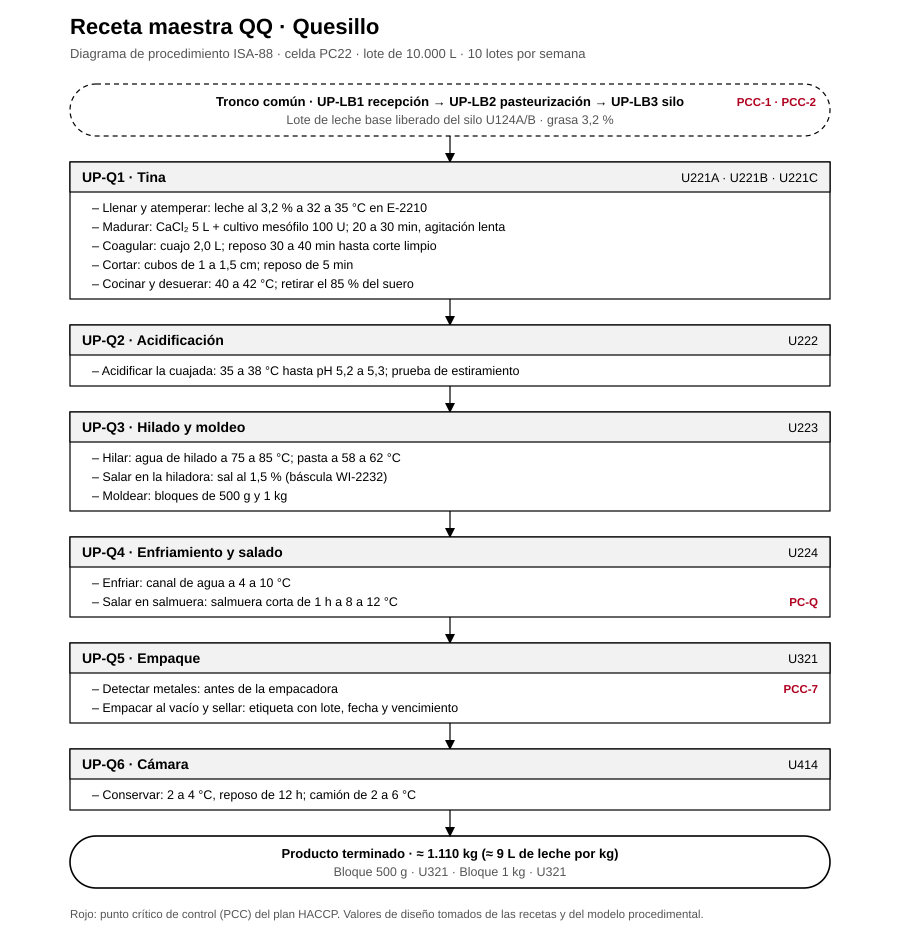

# Receta maestra QQ · Quesillo

Receta maestra ISA-88 de la referencia QQ, ligada a la celda PC22 y a sus unidades. Sale del [modelo físico](../modelo-fisico/modelo-fisico.md), el [modelo procedimental](../modelo-procedimental/modelo-procedimental.md) y las [recetas de la planta](../recetas/recetas.md).

## 1. Encabezado

| Campo | Valor |
|---|---|
| Código | QQ |
| Producto | Quesillo |
| Denominación | Queso de pasta hilada fresca, semiduro a semiblando graso |
| Línea · celda | Quesos · PC22 |
| Tamaño del lote | 10.000 L de leche estandarizada |
| Lotes por semana | 10 |
| Orden de producción | Segundo del día |
| Leche base | Silo U124A/B, grasa 3,2 % |
| Producto por lote | ≈ 1.110 kg (≈ 9 L de leche por kg) |
| Presentaciones | Bloque 500 g · U321 · Bloque 1 kg · U321 |
| Vida útil | 25 días al vacío a 2 a 4 °C |

## 2. Fórmula por lote

| Materia prima o corriente | Cantidad |
|---|---|
| Leche pasteurizada (U124A/B) al 3,2 % | 10.000 L |
| Cloruro de calcio al 40 % | 5 L |
| Cultivo mesófilo | 100 U |
| Cuajo de quimosina | 2,0 L |
| Sal | 1,5 % en la hiladora + salmuera de 1 h |
| Suero dulce que sale a U905 | ≈ 8.900 kg |
| **Producto** | **≈ 1.110 kg (≈ 9 L de leche por kg)** |

## 3. Requerimientos de equipo

E-2210, una tina U221A/B/C, U222, U223 con la báscula de sal WI-2232, U224, U321, U414.

## 4. Procedimiento

Procedimientos de unidad en orden, con sus fases y los valores de esta receta. Antes del primero, el tronco común entrega un lote de leche base liberado (UP-LB1 recepción, UP-LB2 pasteurización a 75 °C por 15 s y UP-LB3 almacenamiento en U124A/B).

| Procedimiento de unidad | Unidad | Fase | Valor de receta | PCC |
|---|---|---|---|---|
| UP-Q1 Tina | U221A · U221B · U221C | Llenar y atemperar | leche al 3,2 % a 32 a 35 °C en E-2210 |  |
|  |  | Madurar | CaCl₂ 5 L + cultivo mesófilo 100 U; 20 a 30 min, agitación lenta |  |
|  |  | Coagular | cuajo 2,0 L; reposo 30 a 40 min hasta corte limpio |  |
|  |  | Cortar | cubos de 1 a 1,5 cm; reposo de 5 min |  |
|  |  | Cocinar y desuerar | 40 a 42 °C; retirar el 85 % del suero |  |
| UP-Q2 Acidificación | U222 | Acidificar la cuajada | 35 a 38 °C hasta pH 5,2 a 5,3; prueba de estiramiento |  |
| UP-Q3 Hilado y moldeo | U223 | Hilar | agua de hilado a 75 a 85 °C; pasta a 58 a 62 °C |  |
|  |  | Salar en la hiladora | sal al 1,5 % (báscula WI-2232) |  |
|  |  | Moldear | bloques de 500 g y 1 kg |  |
| UP-Q4 Enfriamiento y salado | U224 | Enfriar | canal de agua a 4 a 10 °C |  |
|  |  | Salar en salmuera | salmuera corta de 1 h a 8 a 12 °C | PC-Q |
| UP-Q5 Empaque | U321 | Detectar metales | antes de la empacadora | PCC-7 |
|  |  | Empacar al vacío y sellar | etiqueta con lote, fecha y vencimiento |  |
| UP-Q6 Cámara | U414 | Conservar | 2 a 4 °C, reposo de 12 h; camión de 2 a 6 °C |  |

## 5. Especificación del producto terminado

- Humedad 50 a 56 %
- Grasa en extracto seco ≥ 45 % (diseño ≈ 53 %)
- pH 5,2 a 5,5
- Semiduro a semiblando, graso
- Vida útil: 25 días al vacío a 2 a 4 °C

## 6. Puntos críticos de control

| Código | Control |
|---|---|
| PCC-1 | Antibióticos en cada cisterna (recepción) |
| PCC-2 | Pasteurización de la leche a 75 °C por 15 s |
| PCC-7 | Detector de metales antes de la empacadora de quesos |
| PC-Q | Salmuera: concentración, temperatura y pH por turno (punto de control, no PCC) |

Valores de diseño del proyecto; no son mediciones de planta.
