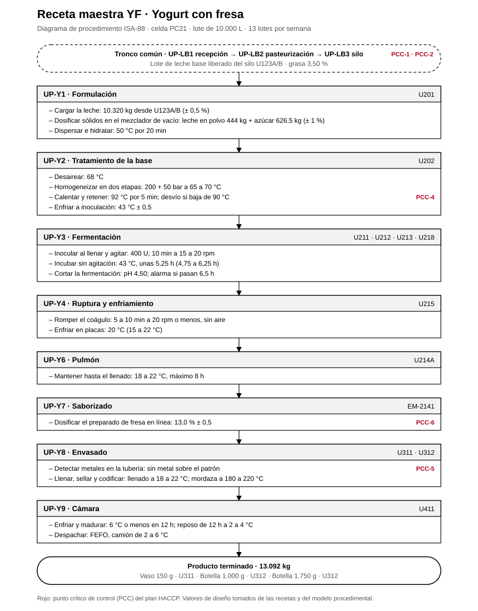

# Receta maestra YF · Yogurt con fresa

Receta maestra ISA-88 de la referencia YF, ligada a la celda PC21 y a sus unidades. Sale del [modelo físico](../modelo-fisico/modelo-fisico.md), el [modelo procedimental](../modelo-procedimental/modelo-procedimental.md) y las [recetas de la planta](../Recetas_y_procesos_planta.pdf).

## 1. Encabezado

| Campo | Valor |
|---|---|
| Código | YF |
| Producto | Yogurt con fresa |
| Denominación | Yogurt entero con dulce, con fresa (Res. 2310 de 1986, art. 21) |
| Línea · celda | Yogurts · PC21 |
| Tamaño del lote | 10.000 L de leche estandarizada |
| Lotes por semana | 13 |
| Orden de producción | Último de la campaña |
| Leche base | Silo U123A/B, grasa 3,50 % |
| Producto por lote | 13.092 kg |
| Presentaciones | Vaso 150 g · U311 · Botella 1.000 g · U312 · Botella 1.750 g · U312 |
| Vida útil | 30 días a 2 a 6 °C |

## 2. Fórmula por lote

| Materia prima o corriente | Cantidad |
|---|---|
| Leche entera estandarizada (U123A/B) | 10.320 kg |
| Leche en polvo descremada | 444 kg |
| Azúcar | 626,5 kg |
| Preparado de fresa en trozos | 1.702 kg (13,0 %) |
| Cultivo DVS (S. thermophilus y L. bulgaricus) | 400 U |
| **Producto** | **13.092 kg** |

## 3. Requerimientos de equipo

U201, U202, un fermentador (U211, U212, U213 o U218), U215, U214A, EM-2141, U311, U312, U411.

## 4. Procedimiento

Procedimientos de unidad en orden, con sus fases y los valores de esta receta. Antes del primero, el tronco común entrega un lote de leche base liberado (UP-LB1 recepción, UP-LB2 pasteurización a 75 °C por 15 s y UP-LB3 almacenamiento en U123A/B).

| Procedimiento de unidad | Unidad | Fase | Valor de receta | PCC |
|---|---|---|---|---|
| UP-Y1 Formulación | U201 | Cargar la leche | 10.320 kg desde U123A/B (± 0,5 %) |  |
|  |  | Dosificar sólidos en el mezclador de vacío | leche en polvo 444 kg + azúcar 626,5 kg (± 1 %) |  |
|  |  | Dispersar e hidratar | 50 °C por 20 min |  |
| UP-Y2 Tratamiento de la base | U202 | Desairear | 68 °C |  |
|  |  | Homogeneizar en dos etapas | 200 + 50 bar a 65 a 70 °C |  |
|  |  | Calentar y retener | 92 °C por 5 min; desvío si baja de 90 °C | PCC-4 |
|  |  | Enfriar a inoculación | 43 °C ± 0,5 |  |
| UP-Y3 Fermentación | U211 · U212 · U213 · U218 | Inocular al llenar y agitar | 400 U; 10 min a 15 a 20 rpm |  |
|  |  | Incubar sin agitación | 43 °C, unas 5,25 h (4,75 a 6,25 h) |  |
|  |  | Cortar la fermentación | pH 4,50; alarma si pasan 6,5 h |  |
| UP-Y4 Ruptura y enfriamiento | U215 | Romper el coágulo | 5 a 10 min a 20 rpm o menos, sin aire |  |
|  |  | Enfriar en placas | 20 °C (15 a 22 °C) |  |
| UP-Y6 Pulmón | U214A | Mantener hasta el llenado | 18 a 22 °C, máximo 8 h |  |
| UP-Y7 Saborizado | EM-2141 | Dosificar el preparado de fresa en línea | 13,0 % ± 0,5 | PCC-6 |
| UP-Y8 Envasado | U311 · U312 | Detectar metales en la tubería | sin metal sobre el patrón | PCC-5 |
|  |  | Llenar, sellar y codificar | llenado a 18 a 22 °C; mordaza a 180 a 220 °C |  |
| UP-Y9 Cámara | U411 | Enfriar y madurar | 6 °C o menos en 12 h; reposo de 12 h a 2 a 4 °C |  |
|  |  | Despachar | FEFO, camión de 2 a 6 °C |  |

## 5. Especificación del producto terminado

- Grasa 2,79 % (≥ 2,5 %)
- Proteína 3,60 % (≥ 2,7 %)
- Sólidos no grasos 10,0 %
- Acidez 0,86 % (0,70 a 1,50 %)
- pH de liberación 4,2 a 4,5
- Fruta neta 6,5 % (≥ 3 %)
- Cultivo viable ≥ 10⁷ UFC/g al vencimiento
- Vida útil: 30 días a 2 a 6 °C

## 6. Puntos críticos de control

| Código | Control |
|---|---|
| PCC-1 | Antibióticos en cada cisterna (recepción) |
| PCC-2 | Pasteurización de la leche a 75 °C por 15 s |
| PCC-4 | Tratamiento de la base a 92 °C por 5 min |
| PCC-5 | Detector de metales antes de las llenadoras de yogurt |
| PCC-6 | Preparado de fruta: certificado, envase íntegro, máximo 24 h a 8 °C o menos |

Valores de diseño del proyecto; no son mediciones de planta.
