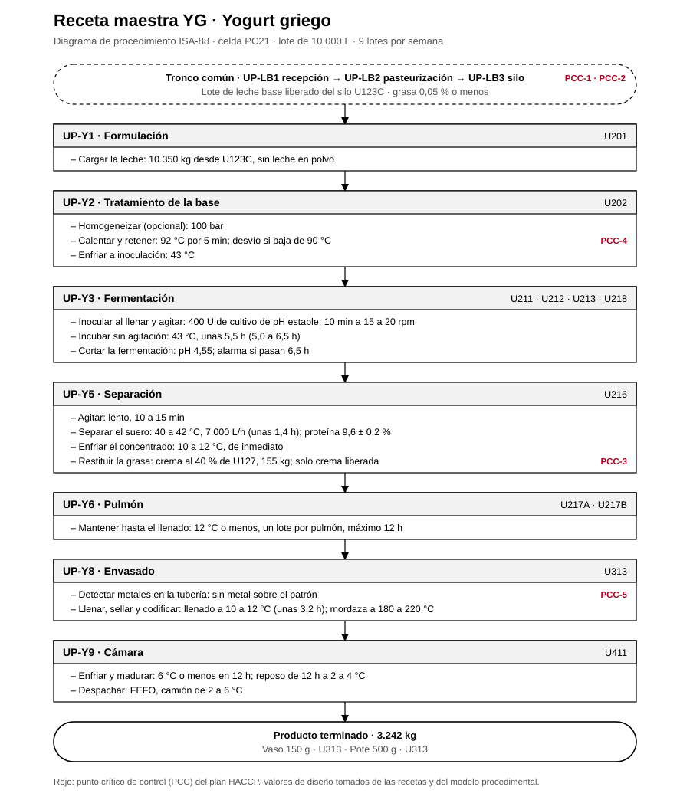

# Receta maestra YG · Yogurt griego

Receta maestra ISA-88 de la referencia YG, ligada a la celda PC21 y a sus unidades. Sale del [modelo físico](../modelo-fisico/modelo-fisico.md), el [modelo procedimental](../modelo-procedimental/modelo-procedimental.md) y las [recetas de la planta](../recetas/recetas.md).

## 1. Encabezado

| Campo | Valor |
|---|---|
| Código | YG |
| Producto | Yogurt griego |
| Denominación | Yogurt griego natural semidescremado, concentrado por separación del suero |
| Línea · celda | Yogurts · PC21 |
| Tamaño del lote | 10.000 L de leche estandarizada |
| Lotes por semana | 9 |
| Orden de producción | Segundo de la campaña |
| Leche base | Silo U123C, grasa 0,05 % o menos |
| Producto por lote | 3.242 kg |
| Presentaciones | Vaso 150 g · U313 · Pote 500 g · U313 |
| Vida útil | 21 días a 2 a 6 °C |

## 2. Fórmula por lote

| Materia prima o corriente | Cantidad |
|---|---|
| Leche descremada (U123C) | 10.350 kg |
| Cultivo DVS de pH estable | 400 U |
| Crema pasteurizada al 40 % (U127) | 155 kg |
| Suero ácido que sale a U905 | 7.263 kg |
| **Producto** | **3.242 kg** |

## 3. Requerimientos de equipo

U201, U202, un fermentador, U216, U127, U217A o U217B, U313, U411.

## 4. Procedimiento

Procedimientos de unidad en orden, con sus fases y los valores de esta receta. Antes del primero, el tronco común entrega un lote de leche base liberado (UP-LB1 recepción, UP-LB2 pasteurización a 75 °C por 15 s y UP-LB3 almacenamiento en U123C).

| Procedimiento de unidad | Unidad | Fase | Valor de receta | PCC |
|---|---|---|---|---|
| UP-Y1 Formulación | U201 | Cargar la leche | 10.350 kg desde U123C, sin leche en polvo |  |
| UP-Y2 Tratamiento de la base | U202 | Homogeneizar (opcional) | 100 bar |  |
|  |  | Calentar y retener | 92 °C por 5 min; desvío si baja de 90 °C | PCC-4 |
|  |  | Enfriar a inoculación | 43 °C |  |
| UP-Y3 Fermentación | U211 · U212 · U213 · U218 | Inocular al llenar y agitar | 400 U de cultivo de pH estable; 10 min a 15 a 20 rpm |  |
|  |  | Incubar sin agitación | 43 °C, unas 5,5 h (5,0 a 6,5 h) |  |
|  |  | Cortar la fermentación | pH 4,55; alarma si pasan 6,5 h |  |
| UP-Y5 Separación | U216 | Agitar | lento, 10 a 15 min |  |
|  |  | Separar el suero | 40 a 42 °C, 7.000 L/h (unas 1,4 h); proteína 9,6 ± 0,2 % |  |
|  |  | Enfriar el concentrado | 10 a 12 °C, de inmediato |  |
|  |  | Restituir la grasa | crema al 40 % de U127, 155 kg; solo crema liberada | PCC-3 |
| UP-Y6 Pulmón | U217A · U217B | Mantener hasta el llenado | 12 °C o menos, un lote por pulmón, máximo 12 h |  |
| UP-Y8 Envasado | U313 | Detectar metales en la tubería | sin metal sobre el patrón | PCC-5 |
|  |  | Llenar, sellar y codificar | llenado a 10 a 12 °C (unas 3,2 h); mordaza a 180 a 220 °C |  |
| UP-Y9 Cámara | U411 | Enfriar y madurar | 6 °C o menos en 12 h; reposo de 12 h a 2 a 4 °C |  |
|  |  | Despachar | FEFO, camión de 2 a 6 °C |  |

## 5. Especificación del producto terminado

- Proteína 9,23 % (≥ 5,6 %)
- Grasa 2,00 % (≥ 1,5 %)
- Acidez de liberación ≤ 1,20 %; ≤ 1,50 % al vencimiento
- pH 4,3 a 4,6
- Vida útil: 21 días a 2 a 6 °C

## 6. Puntos críticos de control

| Código | Control |
|---|---|
| PCC-1 | Antibióticos en cada cisterna (recepción) |
| PCC-2 | Pasteurización de la leche a 75 °C por 15 s |
| PCC-3 | Pasteurización de la crema a 85 °C por 15 s |
| PCC-4 | Tratamiento de la base a 92 °C por 5 min |
| PCC-5 | Detector de metales antes de las llenadoras de yogurt |

Valores de diseño del proyecto; no son mediciones de planta.
