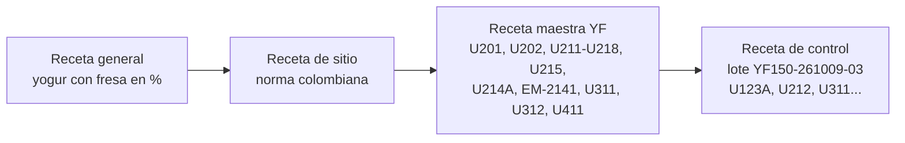

# Recetas y lotes ISA-88

Las recetas responden **¿qué producto fabrico y con qué especificación?** Juntan la fórmula, los equipos que se necesitan y el procedimiento de cada referencia. La planta tiene **nueve referencias**, tres por línea, y todas se hacen en lotes de 10.000 L de leche estandarizada.

Fuente principal: *Recetas y procesos de la planta* (11 de octubre de 2026). Los procedimientos completos, con operaciones y fases, están en el [modelo procedimental](../modelo-procedimental/modelo-procedimental.md).

## 1. Tipos de receta

| Tipo | Qué contiene | En este proyecto |
|---|---|---|
| General | El producto y su proceso, sin equipos ni sitio | El modelo de proceso y la fórmula en porcentaje de cada referencia |
| De sitio | La receta general adaptada a la planta: materias primas locales y normativa del país | Leche de la región y normativa colombiana: Decreto 616 de 2006, Resolución 2310 de 1986, Resolución 1407 de 2022, Resolución 2674 de 2013 |
| Maestra | La receta ligada a una celda y a sus equipos; una por referencia | Las nueve recetas de la sección 4 |
| De control | La copia de la receta maestra para un lote concreto, con su número de lote, cantidades reales y unidades asignadas | Hoy es la orden de lote impresa que prepara el jefe de producción; en la propuesta la generará el MES |

## 2. Estructura de una receta maestra

Cada receta de la sección 4 tiene las mismas partes:

1. **Encabezado.** Código, denominación del producto, línea, tamaño del lote, lotes por semana y lugar en el orden de producción.
2. **Fórmula.** Materias primas con su especificación y cantidad por lote, y el producto y los subproductos que salen.
3. **Requerimientos de equipo.** Las unidades del [modelo físico](../modelo-fisico/modelo-fisico.md) que usa.
4. **Procedimiento.** La secuencia de procedimientos de unidad y los parámetros que cambian respecto a las otras referencias.
5. **Especificación y control.** Requisitos del producto terminado, vida útil y puntos críticos de control (PCC).

## 3. Resumen de las nueve referencias

| Código | Producto | Línea | Lotes por semana | Orden en la campaña | Producto por lote | Presentaciones | Vida útil |
|---|---|---|---|---|---|---|---|
| YN | Yogur natural | Yogures | 13 | Primero | 10.677 kg | Vaso de 200 g, botella de 1000 g | 30 días a 2 a 6 °C |
| YG | Yogur griego | Yogures | 9 | Segundo | 3.242 kg | Vaso de 150 g, pote de 500 g | 21 días a 2 a 6 °C |
| YF | Yogur con fresa | Yogures | 13 | Último | 13.092 kg | Vaso de 150 g, botellas de 1000 y 1750 g | 30 días a 2 a 6 °C |
| QM | Mozzarella | Quesos | 10 | Primero | ≈ 1.000 kg | Bloque de 2,5 kg, barra de 1 kg | 45 días al vacío |
| QQ | Quesillo | Quesos | 10 | Segundo | ≈ 1.110 kg | Bloques de 500 g y 1 kg | 25 días al vacío |
| QD | Doble crema | Quesos | 10 | Último | ≈ 1.330 kg | Bloques de 500 g y 2,5 kg | 30 días al vacío |
| LE | Leche entera UHT | Leche UHT | 14 | Primera | 9.800 cajas de 1 L | Caja de 1 L en bandejas de 12 | 6 meses sin frío |
| LD | Leche descremada UHT | Leche UHT | 6 | Segunda | 9.800 cajas de 1 L | Caja de 1 L en bandejas de 12 | 6 meses sin frío |
| LC | Leche con chocolate UHT | Leche UHT | 6 | Última | ≈ 9.520 cajas de 1 L | Caja de 1 L en bandejas de 12 | 6 meses sin frío |

Producción diaria: yogures unos 58.300 L de leche y 56.400 kg de producto; quesos 50.000 L de leche y unos 5.730 kg de queso; leche UHT unos 43.300 L y 42.200 cajas.

## 4. Recetas maestras

### 4.1 YF · Yogur con fresa

**Encabezado.** Denominación: yogur entero con dulce, con fresa (Resolución 2310 de 1986, art. 21). Celda PC21. Lote de 10.000 L de leche entera estandarizada. 13 lotes por semana; es el último de la campaña.

**Fórmula por lote**

| Materia prima | Especificación | kg por lote | % |
|---|---|---|---|
| Leche entera estandarizada (U123A/B) | 3,50 % de grasa, 3,10 % de proteína, 8,61 % de SNG | 10.320 | 78,8 |
| Leche en polvo descremada | 34 % de proteína | 444 | 3,4 |
| Azúcar (sacarosa) | Refinada, grado alimentario | 626,5 | 4,8 |
| Preparado de fresa en trozos | 50 % de fresa en trozos de 8 a 10 mm, 35 % de sacarosa y fibra de cítricos; pH 3,4 a 3,8; pasteurizado en bolsa aséptica | 1.702 | 13,0 |
| Cultivo DVS | *S. thermophilus* y *L. delbrueckii* subsp. *bulgaricus*; 4 U por cada 100 L de leche | 400 U | — |
| **Producto** | | **13.092** | **100,0** |

No lleva estabilizantes, gelificantes ni emulsificantes: la Resolución 2310 (art. 19) solo los permite en la leche fermentada de larga vida. La textura la dan los sólidos lácteos de la base (11,5 % de SNG) y el tratamiento a 92 °C.

**Requerimientos de equipo.** U201, U202, un fermentador (U211, U212, U213 o U218), U215, U214A, EM-2141, U311 (vasos) y U312 (botellas), U411.

**Procedimiento.** UP-Y1 a UP-Y4, UP-Y6 en U214A, UP-Y7 saborizado, UP-Y8 y UP-Y9. Parámetros clave: base a 50 °C por 20 min; 200 + 50 bar; 92 °C por 5 min; incubación a 43 °C por unas 5,25 h hasta pH 4,50; enfriamiento a 20 °C; preparado de fresa al 13,0 % ± 0,5 %; llenado a 18 a 22 °C. Detalle en el [modelo procedimental, sección 3.1](../modelo-procedimental/modelo-procedimental.md#31-yogur-con-fresa-yf-operaciones-y-fases).

**Especificación**

| Parámetro | Diseño | Requisito | Norma |
|---|---|---|---|
| Grasa láctea | 2,79 % | ≥ 2,5 % (entero) | Res. 2310 de 1986, art. 13 |
| Proteína láctea | 3,60 % | ≥ 2,7 % | Codex CXS 243-2003 |
| Sólidos lácteos no grasos | 10,0 % | ≥ 7,0 % | Res. 2310 de 1986 |
| Acidez titulable | 0,86 %; liberación ≥ 0,75 % | 0,70 a 1,50 % | Res. 2310 de 1986, art. 13 |
| pH de liberación | 4,2 a 4,5 | — | Tetra Pak |
| Fruta neta | 6,5 % | ≥ 3 % | Res. 2310 de 1986, art. 20 |
| Cultivo viable al vencimiento | ≥ 10⁷ UFC/g | ≥ 10⁷ UFC/g | Codex CXS 243-2003 |
| Vida útil | 30 días a 2 a 6 °C | Acidez ≤ 1,50 % al vencimiento | Protocolo de vida útil |

**PCC.** PCC-1, PCC-2 (tronco común) · PCC-4 tratamiento de la base · PCC-5 metales · PCC-6 preparado de fruta (certificado del proceso térmico del proveedor, envase íntegro, conectado máximo 24 h a 8 °C o menos).

### 4.2 YN · Yogur natural

**Encabezado.** Denominación: yogur entero sin dulce (nombre comercial: natural). Celda PC21. Lote de 10.000 L. 13 lotes por semana; abre la campaña.

**Fórmula por lote**

| Materia prima | Especificación | kg por lote | % |
|---|---|---|---|
| Leche entera estandarizada (U123A/B) | 3,50 % de grasa, 3,10 % de proteína, 8,61 % de SNG | 10.320 | 96,7 |
| Leche en polvo descremada | 34 % de proteína | 357 | 3,3 |
| Cultivo DVS suave | *S. thermophilus* y *L. bulgaricus* de baja postacidificación | 400 U | — |
| **Producto** | | **10.677** | **100,0** |

**Requerimientos de equipo.** U201, U202, un fermentador, U215, U214B, U311 (vasos) y U312 (botellas), U411. El dosificador de fruta EM-2141 queda aislado con válvulas.

**Procedimiento.** El mismo de la fresa, sin azúcar ni fruta. Corte a pH 4,50 en unas 5,0 h (4,5 a 6,0 h). Pulmón U214B.

**Especificación.** Grasa 3,42 %; proteína 4,14 %; acidez 0,85 a 1,05 % con liberación ≥ 0,75 %; pH 4,2 a 4,5; vida útil de 30 días. No lleva sellos frontales porque no se le añade sal, azúcar ni grasa (Resolución 810 de 2021, modificada por la 2492 de 2022).

**PCC.** PCC-1, PCC-2, PCC-4 y PCC-5.

### 4.3 YG · Yogur griego

**Encabezado.** Denominación: yogurt griego natural semidescremado, concentrado por separación del suero. En el Codex es una leche fermentada concentrada (proteína ≥ 5,6 %). Celda PC21. Lote de 10.000 L de leche descremada. 9 lotes por semana; va después del natural.

**Fórmula y balance por lote**

| Corriente | kg por lote | Grasa | Proteína | Destino |
|---|---|---|---|---|
| Leche descremada (U123C), 10.000 L | 10.350 | 0,05 % | 3,21 % | Formulación, sin leche en polvo |
| Cultivo DVS de pH estable | 400 U | — | — | Fermentador |
| Concentrado del separador U216 | 3.087 | 0,10 % | 9,60 % | Restitución de grasa |
| Suero ácido (pH 4,4 a 4,6) | 7.263 | 0,03 % | 0,5 % | U905 |
| Crema pasteurizada al 40 % (U127) | 155 | 40 % | 1,9 % | Dosificada en línea |
| **Yogur griego** | **3.242** | **2,00 %** | **9,23 %** | U217A o B, y luego U313 |

Por cada kg de griego se usan 3,19 kg de leche descremada y salen 2,24 kg de suero ácido. El suero (unos 10.900 kg/día) no se vierte: va a U905 para venta o alimentación animal.

**Requerimientos de equipo.** U201, U202, un fermentador, U216, U127, U217A o U217B (uno por lote), U313, U411.

**Procedimiento.** UP-Y1, UP-Y2 (homogeneización opcional a 100 bar), UP-Y3 con corte a pH 4,55 en unas 5,5 h, UP-Y5 separación a 40 a 42 °C y 7.000 L/h, enfriamiento a 10 a 12 °C y 155 kg de crema, UP-Y6 en U217A/B a 12 °C o menos, UP-Y8 en U313 (llenado a 10 a 12 °C), UP-Y9. Detalle en el [modelo procedimental, sección 3.3](../modelo-procedimental/modelo-procedimental.md#33-yogur-griego-yg-operaciones-y-fases-propias).

**Especificación.** Proteína 9,23 % (mínimo 5,6 %); grasa 2,00 % (semidescremado, mínimo 1,5 %); acidez de liberación ≤ 1,20 % y ≤ 1,50 % al vencimiento; pH 4,3 a 4,6; vida útil de 21 días a 2 a 6 °C.

**PCC.** PCC-1, PCC-2, PCC-3 (crema añadida sin otro tratamiento térmico), PCC-4 y PCC-5.

### 4.4 QM · Mozzarella

**Encabezado.** Queso de pasta hilada de baja humedad (45 a 52 %), en bloque y barra, para pizzerías y restaurantes que lo rallan o tajan; por eso se empaca al vacío y no en líquido. Celda PC22. Lote de 10.000 L. 10 lotes por semana; primero del día.

**Fórmula por lote**

| Insumo | Cantidad | Función |
|---|---|---|
| Leche pasteurizada (U124A/B) al 3,0 % de grasa | 10.000 L | Base |
| Cloruro de calcio en solución al 40 % m/v | 5 L (2,0 kg de CaCl₂) | Repone el calcio que se pierde al pasteurizar y da firmeza al coágulo |
| Cultivo termófilo (*S. thermophilus* y *L. delbrueckii* subsp. *bulgaricus*) | 200 U (2 U por cada 100 L) | Acidifica la cuajada hasta el pH de hilado |
| Cuajo de quimosina (≈ 200 IMCU/mL) | 2,0 L | Coagula la leche en 30 a 40 min |
| Sal | Salmuera al 20 % por 8 h | Sabor, conservación y firmeza |
| **Producto** | **≈ 1.000 kg** (≈ 10 L de leche por kg) | Bloques de 2,5 kg y barras de 1 kg |
| Suero dulce | ≈ 9.000 kg | A U905, para alimentación animal |

**Requerimientos de equipo.** E-2210, una tina U221A/B/C, U222, U223, U224, U321, U414.

**Procedimiento.** UP-Q1 a UP-Q6. Hilado con pH de 5,1 a 5,3; salmuera de 8 h a 8 a 12 °C.

**Especificación.** Humedad 45 a 52 %; grasa en extracto seco ≥ 45 % (diseño unos 50 %); pH 5,1 a 5,4; clase semiduro graso (Resolución 2310, art. 45); vida útil de 45 días al vacío a 2 a 4 °C.

**PCC.** PCC-1, PCC-2 y PCC-7 (metales antes de la empacadora). La salmuera es un punto de control (PC-Q).

### 4.5 QQ · Quesillo

**Encabezado.** Queso de pasta hilada fresca. Celda PC22. Lote de 10.000 L. 10 lotes por semana; segundo del día.

**Fórmula por lote**

| Insumo | Cantidad | Función |
|---|---|---|
| Leche pasteurizada (U124A/B) al 3,2 % de grasa | 10.000 L | Base |
| Cloruro de calcio en solución al 40 % m/v | 5 L | Firmeza del coágulo |
| Cultivo mesófilo (*Lactococcus lactis* subsp. *lactis* y *cremoris*) | 100 U (1 U por cada 100 L) | Acidifica la cuajada |
| Cuajo de quimosina | 2,0 L | Coagulación |
| Sal | 1,5 % en la hiladora y salmuera corta de 1 h | Sabor y conservación |
| **Producto** | **≈ 1.110 kg** (≈ 9 L de leche por kg) | Bloques de 500 g y 1 kg |
| Suero dulce | ≈ 8.900 kg | A U905 |

**Requerimientos de equipo.** Los mismos de la mozzarella, más la báscula de sal WI-2232.

**Procedimiento.** UP-Q1 a UP-Q6. Hilado con pH de 5,2 a 5,3; sal en la hiladora; salmuera de 1 h.

**Especificación.** Humedad 50 a 56 %; grasa en extracto seco ≥ 45 % (diseño unos 53 %); pH 5,2 a 5,5; clase semiduro a semiblando, graso; vida útil de 25 días al vacío a 2 a 4 °C.

**PCC.** PCC-1, PCC-2 y PCC-7. PC-Q en la salmuera.

### 4.6 QD · Doble crema

**Encabezado.** Queso de pasta hilada con más grasa y humedad. Celda PC22. Lote de 10.000 L. 10 lotes por semana; último del día.

**Fórmula por lote**

| Insumo | Cantidad | Función |
|---|---|---|
| Leche pasteurizada (U124A/B) al 3,6 % de grasa | 9.840 L | Base |
| Crema pasteurizada al 40 % (U127) | 160 L | Sube la grasa de la mezcla a 4,2 % |
| Cloruro de calcio en solución al 40 % m/v | 5 L | Firmeza del coágulo |
| Cultivo mesófilo | 100 U | Acidifica la cuajada |
| Cuajo de quimosina | 2,2 L | Coagulación (un poco más por la grasa) |
| Sal | 1,2 % en la hiladora, sin salmuera | Sabor y conservación |
| **Producto** | **≈ 1.330 kg** (≈ 7,5 L de leche por kg) | Bloques de 500 g y 2,5 kg |
| Suero dulce | ≈ 8.700 kg | A U905 |

La grasa de la mezcla sale de (9.840 × 3,6 % + 160 × 40 %) / 10.000 = 4,2 %.

**Requerimientos de equipo.** Los de la mozzarella, más U127 y el contador FQI-2212 de la crema.

**Procedimiento.** UP-Q1 (la crema se añade al llenar la tina; la cocción va en el límite inferior para retener humedad) a UP-Q6. Hilado con pH de 5,2 a 5,3; después del hilado solo se enfría en agua.

**Especificación.** Humedad 50 a 55 %; grasa en extracto seco ≥ 45 % (diseño unos 58 %); pH 5,1 a 5,4; clase semiduro graso; vida útil de 30 días al vacío a 2 a 4 °C.

**PCC.** PCC-1, PCC-2, PCC-3 (crema) y PCC-7.

**Verificaciones comunes a los tres quesos.** Los 2,0 kg de cloruro de calcio dan unos 194 mg por kg de leche, por debajo del máximo de 200 mg/kg (Resolución 2310, art. 46). El cuajo da unos 40 IMCU por litro (44 en la doble crema). La sal en el queso no pasa del 4 % (art. 46). Criterios microbiológicos de la Resolución 1407 de 2022 para queso fresco, con *Salmonella* y *Listeria monocytogenes* ausentes en 25 g.

### 4.7 LE · Leche entera UHT

**Encabezado.** Leche de larga vida esterilizada a ultra alta temperatura (UAT en el Decreto 616 de 2006) y envasada en condiciones asépticas. Celda PC23. Lote de 10.000 L. 14 lotes por semana; primera del día.

**Fórmula.** 10.000 L de leche pasteurizada de U125A estandarizada al 3,0 %. Producto: unas 9.800 cajas de 1 L (2 % de merma en purgas y arranques).

**Requerimientos de equipo.** U231, U232, U233, U331, U413.

**Procedimiento.** UP-L1 (verificar la grasa) a UP-L5. Esterilización a 137 °C por 4 s, homogeneización aséptica a 200/50 bar a unos 70 °C, enfriamiento a 20 a 25 °C, envasado aséptico y retención hasta la liberación.

**Especificación.** Grasa ≥ 3,0 % m/v; acidez 0,13 a 0,17 %; fosfatasa y peroxidasa negativas; esterilidad comercial sin crecimiento (NTC 4433); residuo de peróxido en el envase ≤ 0,5 ppm; vida útil de 6 meses a temperatura ambiente sin abrir.

**PCC.** PCC-1, PCC-2, PCC-8 (esterilización) y PCC-9 (envasado aséptico).

### 4.8 LD · Leche descremada UHT

**Encabezado.** Celda PC23. Lote de 10.000 L. 6 lotes por semana; va después de la entera.

**Fórmula.** 10.000 L de leche de U125B descremada al 0,3 %; la crema sobrante sale de U121 hacia U126. Producto: unas 9.800 cajas de 1 L.

**Requerimientos de equipo y procedimiento.** Los de la leche entera.

**Especificación.** Grasa 0,1 a 0,5 % m/v; el resto igual que la entera.

**PCC.** PCC-1, PCC-2, PCC-8 y PCC-9.

### 4.9 LC · Leche con chocolate UHT

**Encabezado.** Leche saborizada. Celda PC23. Lote de 10.000 L. 6 lotes por semana; última del día, por el cacao.

**Fórmula por lote**

| Insumo | Cantidad | Función |
|---|---|---|
| Leche pasteurizada (U125A) al 3,0 % | 9.210 L | Base |
| Azúcar (sacarosa) | 620 kg (6,0 %) | Dulzor |
| Cacao en polvo alcalinizado | 125 kg (1,2 %) | Sabor y color; se dispersa mejor y tiene un pH cercano a 7 |
| Carragenina kappa | 2,6 kg (0,025 %) | Mantiene el cacao en suspensión |
| **Producto** | **10.250 kg (≈ 9.720 L)** | ≈ 9.520 cajas de 1 L, con 2 % de merma |

**Requerimientos de equipo.** U231 con la báscula WI-2312, la tolva y el mezclador EM-2313; U232, U233, U331, U413.

**Procedimiento.** UP-L1 con la leche a 60 a 65 °C, la carragenina premezclada en seco con azúcar (1 a 10) y 20 min de mezcla con recirculación; luego UP-L2 a UP-L5 como la entera. Al terminar, limpieza de la planta UHT antes de volver a leche entera.

**Especificación.** Grasa unos 2,7 % (mínimo 2,5 %); sólidos lácteos no grasos 7,7 a 8,0 %; acidez 0,12 a 0,16 %; esterilidad comercial; residuo de peróxido ≤ 0,5 ppm; vida útil de 6 meses. La carragenina queda lejos del máximo de 5 g/kg de la Resolución 2310.

**PCC.** PCC-1, PCC-2, PCC-8 y PCC-9.

## 5. Presentaciones de la línea de yogures

| Referencia | Envase | Llenadora | Velocidad | Unidades por día | Unidades por caja |
|---|---|---|---|---|---|
| YF150 | Vaso de PP con foil termosellado | U311 | 12.000/h | 85.098 | 24 |
| YF1000 | Botella de PEAD con sello de inducción | U312 | 4.000/h | 9.928 | 12 |
| YF1750 | Botella de PEAD con asa | U312 | 2.500/h | 3.242 | 6 |
| YN200 | Vaso de PP con foil termosellado | U311 | 10.000/h | 46.268 | 24 |
| YN1000 | Botella de PEAD con sello de inducción | U312 | 4.000/h | 13.881 | 12 |
| YG150 | Vaso de PP con foil y sobretapa | U313 | 6.000/h | 19.449 | 24 |
| YG500 | Pote de PP con foil y sobretapa | U313 | 2.400/h | 3.890 | 12 |

En cada llenadora se controla el peso neto (Resolución SIC 32209 de 2020), la temperatura de la mordaza (180 a 220 °C según el foil) y la codificación de lote y vencimiento. El detector de metales va en la tubería antes de cada llenadora, porque el foil de aluminio impide detectar metales no ferrosos después de sellar.

## 6. Diferenciación entre referencias

El enunciado pide que las referencias de cada línea se diferencien de forma no trivial. Así se cumple:

| Criterio del enunciado | Yogures | Quesos | Leche UHT |
|---|---|---|---|
| Ingredientes y formulación | Azúcar y fruta en fresa; ninguno en natural; leche descremada y crema en griego | Grasa de 3,0, 3,2 y 4,2 %; crema propia en doble crema | Leche entera, descremada o con azúcar, cacao y carragenina |
| Cantidades y dosificación | 444, 357 o 0 kg de leche en polvo; 13 % de fresa; 155 kg de crema | 2,0 o 2,2 L de cuajo; 200 o 100 U de cultivo; 1,5 o 1,2 % de sal | 620 kg de azúcar, 125 kg de cacao y 2,6 kg de carragenina en chocolate |
| Parámetros, temperaturas y tiempos | Corte a pH 4,50 o 4,55; 5,0, 5,25 o 5,5 h de incubación | pH de hilado 5,1 a 5,3 o 5,2 a 5,3; salmuera de 8 h, 1 h o ninguna | Mezcla a 60 a 65 °C solo en chocolate |
| Secuencia de operación | El griego pasa por separador; solo la fresa pasa por el dosificador | La doble crema no pasa por salmuera | El chocolate va al final y obliga a lavar la UHT |
| Velocidades y capacidades | Llenadoras de 2.400 a 12.000 envases/h según el formato | Rendimientos de 10, 9 y 7,5 L/kg | 9.800 o 9.520 cajas por lote |
| Presentación y envase | Vasos de 150 y 200 g, botellas de 1000 y 1750 g, potes de 500 g | Bloques y barras de 500 g a 2,5 kg | Caja de 1 L |
| Inspección y calidad | PCC-6 solo en fresa; PCC-3 solo en griego; vida útil de 30 o 21 días | Humedad y clase distintas; vida útil de 45, 25 o 30 días | Grasa de 3,0, 0,3 o 2,7 % |
| Información y trazabilidad | Lote del preparado de fruta (fresa) y de la crema (griego) | Lote de crema en doble crema | Lote del cacao y retención por esterilidad |

## 7. Lotes y trazabilidad

### Tamaño del lote

Todos los lotes son de **10.000 L** de leche estandarizada, que caben en los fermentadores de 12.000 L, las tinas de 10.000 L y el tanque de mezcla de 12.000 L.

### Identificación

| Qué se identifica | Cómo |
|---|---|
| Cisterna | Proveedor, ruta, volumen y sellos al llegar, con el resultado del laboratorio |
| Lote de leche base | Silo y fecha; se libera con fosfatasa y peroxidasa antes de transferir. Formato propuesto en este modelo: `LB-<silo>-AAMMDD-NN`, por ejemplo `LB-U123A-261009-02` |
| Lote de producto | Referencia, fecha y consecutivo del día, impresos en cada envase con el vencimiento. Ejemplo de las recetas de yogures: `YF150-261009-03` |
| Insumos críticos | Lote del cultivo (anotado en la planilla), del preparado de fruta, de la crema y del cacao |

Cada línea toma la leche de un silo con lote liberado, así que la cadena queda encadenada: **cisterna → lote de leche base → lote de producto → despacho**.

### Ejemplo de receta de control

Lote de yogur con fresa en vaso de 150 g. Las unidades y el lote de leche son un ejemplo de asignación.

| Campo | Valor |
|---|---|
| Receta maestra | YF · Yogur con fresa |
| Lote de producto | YF150-261009-03 |
| Tamaño | 10.000 L de leche estandarizada (10.320 kg) |
| Leche base | Lote liberado del silo U123A |
| Unidades asignadas | U201 · U202 · fermentador U212 · U215 · U214A · EM-2141 · U311 · U411 |
| Parámetros | Los de la receta maestra: 92 °C por 5 min, 43 °C, corte a pH 4,50, fresa al 13,0 % |
| Insumos | 444 kg de leche en polvo, 626,5 kg de azúcar, 1.702 kg de preparado de fresa, 400 U de cultivo, con sus lotes |

### Registro de lote

**Hoy, en la empresa base**, el registro de un lote está repartido:

| Dato | Dónde queda |
|---|---|
| Leche recibida, temperaturas de pasteurización, niveles de silos, ciclos de CIP | Historiador del SCADA (tronco común) |
| Análisis de la cisterna, liberación de leche base y producto | Libro y Excel del laboratorio |
| Cantidades cargadas, pH, tiempos y lote del cultivo | Planilla del lote, en papel |
| Tratamiento de la base (U202) y esterilización UHT (U232) | Registro impreso de cada máquina, firmado y archivado |
| Envases producidos | Contador de cada llenadora, copiado al final del turno |
| Temperatura de las cámaras | Registradores que se descargan cada semana |

Por eso la trazabilidad de un lote se arma juntando registros de varias áreas, y el mismo dato se escribe varias veces (planilla, Excel de producción y ERP).

**Lo que debe tener el registro de lote** para reconstruir la historia de cualquier lote:

| Grupo | Datos |
|---|---|
| Identificación | Lote, receta maestra, orden de producción, fecha, turno y operador |
| Genealogía | Lote de leche base y cisternas de origen; lotes de leche en polvo, azúcar, cultivo, cuajo, fruta, crema, cacao y envases |
| Equipos | Unidades usadas y su última limpieza |
| Parámetros | Curvas de temperatura y pH, presión de homogeneización, tratamientos térmicos y desvíos |
| Eventos | Alarmas, paradas e intervenciones del operador |
| Cantidades y calidad | Cantidad programada y producida, rechazos, resultados de laboratorio y liberación |

Llevar este registro a un MES es parte de la propuesta de automatización.

## 8. Normativa

- Decreto 616 de 2006 (Ministerio de la Protección Social): leche cruda, leche de consumo y tratamiento UAT.
- Resolución 2310 de 1986 (Ministerio de Salud): derivados lácteos, aditivos, clases de queso y límites de cloruro de calcio y sal.
- Resolución 1407 de 2022: criterios microbiológicos.
- Resolución 2674 de 2013: buenas prácticas de manufactura.
- Resolución 810 de 2021, modificada por la 2492 de 2022: etiquetado nutricional y frontal.
- Resolución SIC 32209 de 2020: control metrológico de preempacados.
- Codex Alimentarius CXS 243-2003 (leches fermentadas) y CXS 262-2006 (mozzarella).
- NTC 4433: esterilidad comercial.
