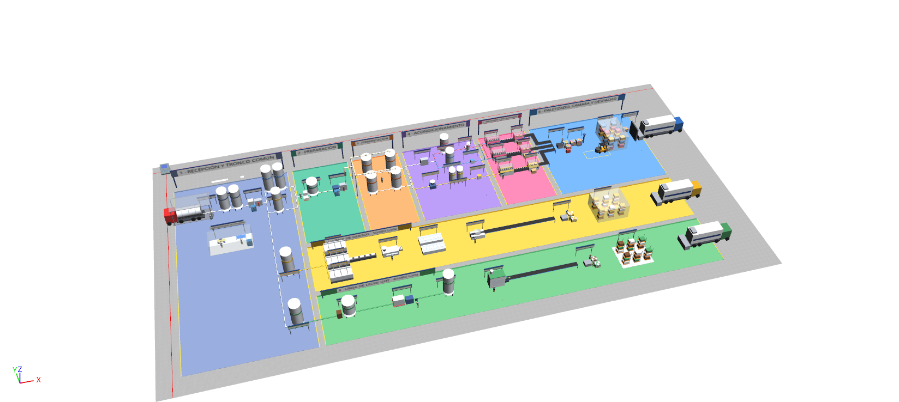
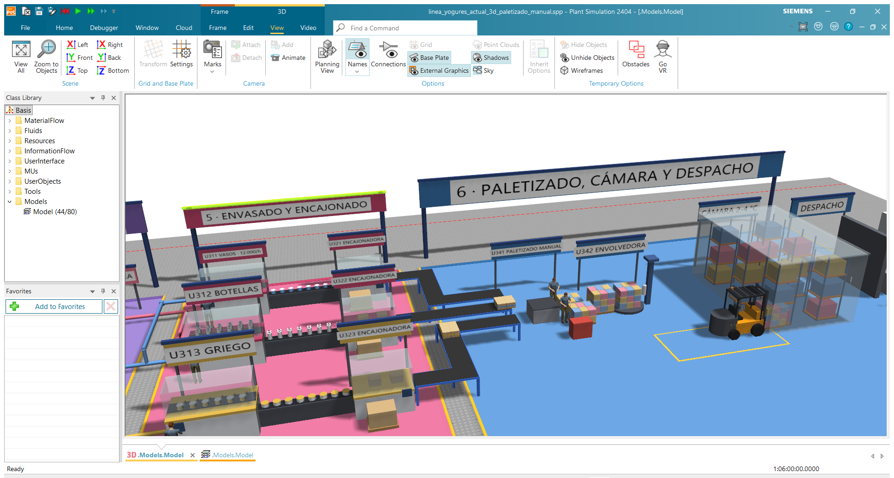
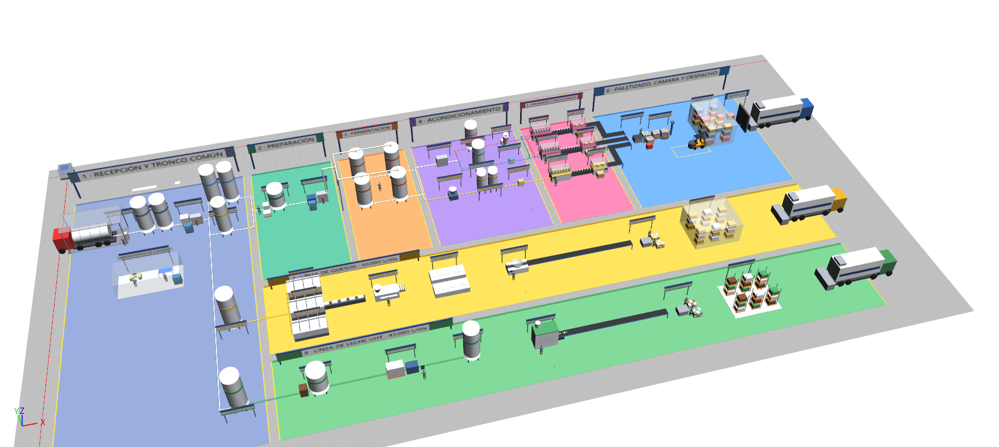

# Simulación en Tecnomatix Plant Simulation

Modelos de la planta de Lácteos Altos de Teusacá en su **estado actual** (sin la automatización de Mekvra), hechos en Plant Simulation 2404 con licencia estudiantil (máximo 80 objetos). Cada modelo se arma con SimTalk desde Python por la interfaz COM. Se simulan 12 semanas de 6 días de producción, con lotes de 10.000 L, el programa semanal de producción, fallas aleatorias, limpiezas CIP, cambios de formato y un OEE de llenadoras de ≈ 70 %. Todas las cifras son de simulación, no medidas de planta.

## Modelos

| Archivo | Contenido |
|:--|:--|
| [`planta-150k/planta_150k_3d.spp`](planta-150k) | **Planta completa de 150.000 L/día** con su escena 3D: recepción y tronco común, línea de yogures, línea de quesos y línea de leche UHT, cada una con paletizado manual, cámara y despacho. 66 de los 80 objetos de la licencia. |
| [`planta-150k/planta_150k.spp`](planta-150k) | El mismo modelo, solo en 2D. |
| [`linea-yogures/linea_yogures_actual_3d_paletizado_manual.spp`](linea-yogures) | **Línea de yogures en detalle** (fresa, natural y griego) con su escena 3D, dividida en seis secciones con cartel. El paletizado U341 lo hacen dos operarios a mano (150 s por bulto). Queda guardado a las 67,75 h simuladas, así que al dar Play las tres llenadoras ya están trabajando y se ven las cajas en las bandas. |

Los equipos usan los códigos del modelo físico ISA-88 y del P&ID del grupo. En el modelo de la línea de yogures las estaciones de encajonado conservan los nombres `U321`–`U323`; en el de la planta se llaman `Cajas_vasos`, `Cajas_botellas` y `Cajas_griego`, porque `U321` es el empaque al vacío de quesos.

## Resultados de 12 semanas

**Planta completa** (`planta-150k/resultados_planta.json`)

| Línea | Leche al día | Producto al día | Equipo más cargado |
|:--|--:|:--|:--|
| Tronco común | 151.667 L recibidos | — | Recepción U111 38 % · pasteurizador U121 32 % |
| Yogures | 57.500 L | 128.000 vasos · 26.400 botellas · 22.900 potes de griego | Llenadora de vasos U311 87 % (cuello de botella) |
| Quesos | 49.444 L | ≈ 5.670 kg de queso | Hiladora U223 y empaque U321 27 % |
| Leche UHT | 43.056 L | ≈ 42.300 envases | Envasadora aséptica U331 40 % |

**Línea de yogures con paletizado manual** (`linea-yogures/resultados_paletizado_manual.json`): 57.639 L/día. Llenadora de vasos U311 88 % (cuello de botella), botellas U312 68 %, griego U313 43 %, fermentadores 45 % y paletizado manual U341 81 %: cuando las tres llenadoras trabajan al tiempo, las cajas se acumulan en la mesa porque dos personas no alcanzan.

## Cómo abrirlos

1. En Plant Simulation, File → Open y elige el `.spp`.
2. Abre la pestaña **3D .Models.Model** y presiona Play. En `linea-yogures` no presiones Reset, para conservar el arranque en caliente.
3. Rueda del ratón para acercar, botón central para girar y botón derecho para mover. En la cinta 3D, View → View All encuadra todo el modelo.

| Planta completa | Línea de yogures con paletizado manual |
|:--:|:--:|
|  |  |

## Cómo se regeneran

Los tiempos de la línea de yogures salen de [`recetas_yogures.json`](../../01_transformacion-digital/isa88/recetas/recetas_yogures.json); los de quesos y leche UHT son supuestos de diseño que están al inicio de `construir_planta.py`.

- **Planta:** `python construir_planta.py planta_150k.spp 12` construye y simula el 2D y escribe `resultados_planta.json` y `coords_planta.json`. Luego `generar_planta_3d.ps1` crea la escena 3D y aplica la decoración de `decorar_planta.py`.
- **Línea de yogures:** `generar_3d.ps1` construye el modelo con `construir_yogures.py`, crea la escena 3D y aplica `decorar_3d.py`. La variante con paletizado manual se arma sobre esa escena con `PALETIZADO=manual python decorar_3d.py` (mesa de rodillos, dos operarios y estibas) y con U341 como estación de 150 s por bulto.
- Los scripts `.ps1` manejan la ventana de Plant Simulation, así que el PC debe estar libre mientras corren.
- `iconos/` tiene los íconos 2D de los equipos (`dibujar_iconos.py`, `dibujar_iconos_vsm.py`).

Límites de la licencia estudiantil: 80 objetos por modelo y sin la librería de VSM de Siemens. Los vehículos, tanques, carteles y la nave son figuras 3D de SimTalk y gráficos de la biblioteca de Plant Simulation (robot, operarios), que no cuentan como objetos.
