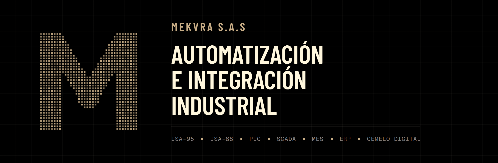
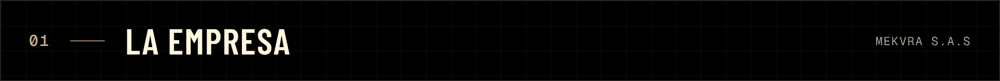
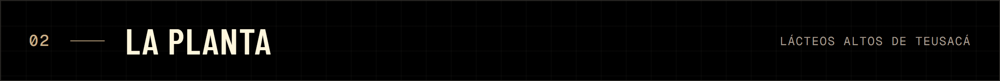
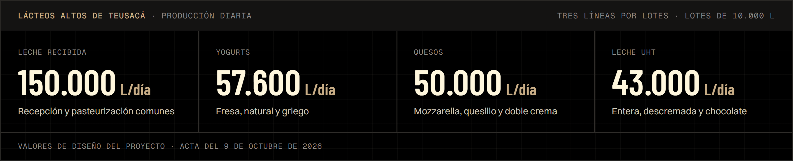
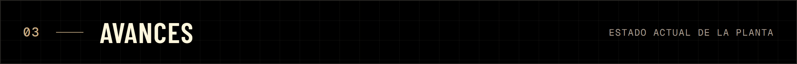
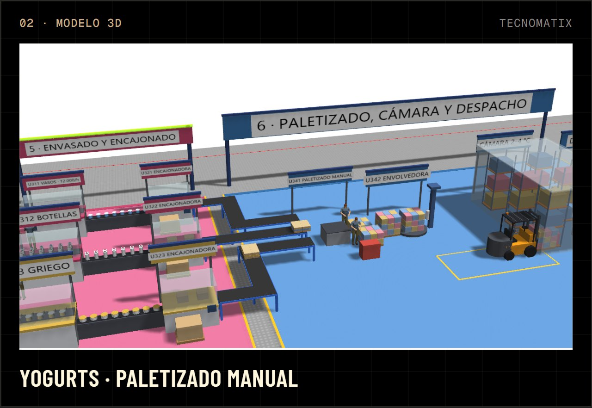
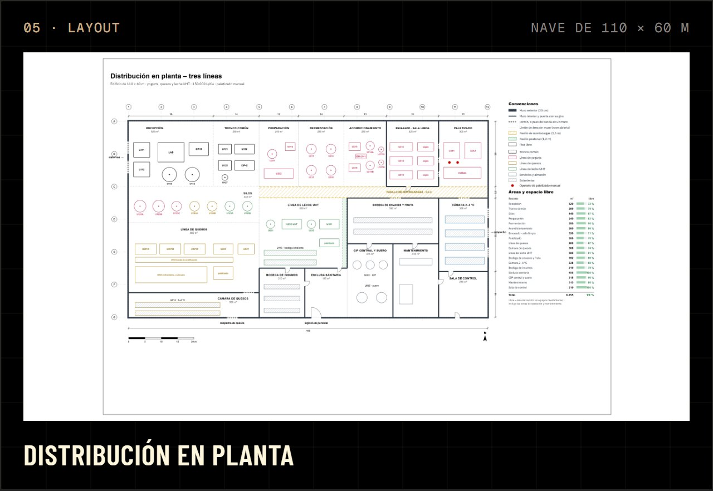
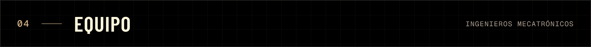
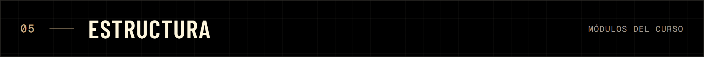

  

  
  
  
  

  <a href="https://mekvra.github.io/proyecto-integrador/"><b>Página web</b></a>
  &nbsp;&nbsp;·&nbsp;&nbsp;
  <a href="#la-empresa">La empresa</a>
  &nbsp;&nbsp;·&nbsp;&nbsp;
  <a href="#la-planta">La planta</a>
  &nbsp;&nbsp;·&nbsp;&nbsp;
  <a href="#avances">Avances</a>
  &nbsp;&nbsp;·&nbsp;&nbsp;
  <a href="#equipo">Equipo</a>
  &nbsp;&nbsp;·&nbsp;&nbsp;
  <a href="#estructura">Estructura</a>

 

**Mekvra S.A.S** es una empresa integradora de soluciones de **Transformación Digital Industrial**, formada por ingenieros mecatrónicos. Conectamos el proceso físico con la gestión del negocio: del sensor en el tanque a la decisión en la gerencia.

<table>
  <tr>
    <td width="33%" valign="top">
      <b>Qué hacemos</b>  
      Integramos instrumentación, control, robótica, SCADA, MES y ERP en una sola arquitectura, sobre los estándares ISA-95 e ISA-88.
    </td>
    <td width="33%" valign="top">
      <b>Nuestro cliente</b>  
      Lácteos Altos de Teusacá, planta de derivados lácteos en Zipaquirá, Cundinamarca, con tres líneas de producción por lotes.
    </td>
    <td width="33%" valign="top">
      <b>El proyecto</b>  
      Proyecto Integrador de Automatización de Procesos de Manufactura 2026-2S, Universidad Nacional de Colombia, Sede Bogotá.
    </td>
  </tr>
</table>

 

La planta recibe la leche por un tronco común (recepción, pasteurización y silos) y la reparte entre tres líneas por lotes, según el acta del 9 de octubre de 2026.

| Línea | Productos | Alcance en el proyecto |
|:--|:--|:--|
| **Yogurts** | Fresa, natural y griego | Línea detallada: recetas ISA-88, simulación, VSM, layout y espagueti |
| **Quesos** | Mozzarella, quesillo y doble crema | Recetas básicas y simulación de la planta |
| **Leche UHT** | Entera, descremada y con chocolate | Recetas básicas y simulación de la planta |

 

Análisis de la planta en su estado actual, antes de la propuesta de automatización. Cada imagen abre el documento completo.

<table>
  <tr>
    <td width="50%" valign="top">
      
      Planta completa en Plant Simulation: tronco común y líneas de yogurts, quesos y leche UHT.
    </td>
    <td width="50%" valign="top">
      
      Línea de yogurts en seis secciones, de la recepción al despacho, con paletizado manual.
    </td>
  </tr>
  <tr>
    <td width="50%" valign="top">
      
      Mapa de flujo de valor de las tres líneas sobre el tronco común.
    </td>
    <td width="50%" valign="top">
      
      Mapa de flujo de valor de la línea de yogurts, de la recepción a la cámara.
    </td>
  </tr>
  <tr>
    <td width="50%" valign="top">
      
      Plano de la nave de 110 × 60 m con las tres líneas.
    </td>
    <td width="50%" valign="top">
      
      Recorridos diarios de personas y montacargas en la línea de yogurts.
    </td>
  </tr>
</table>

**Documentos**

| Módulo | Documento | Contenido |
|:--|:--|:--|
| Transformación digital | [Recetas y procesos de la planta](01_transformacion-digital/isa88/Recetas_y_procesos_planta.pdf) | Fórmulas, procedimientos, parámetros, PCC y equipos de las tres líneas |
| Transformación digital | [Modelo ISA-88](01_transformacion-digital/isa88) | Modelo físico, modelo procedimental y [recetas maestras](01_transformacion-digital/isa88/recetas-maestras) de los 9 productos, con [diagramas](01_transformacion-digital/isa88/diagramas) |
| Transformación digital | [Recetas de la línea de yogurts](01_transformacion-digital/isa88/recetas/Recetas_linea_yogures_v1.8.pdf) | Fresa, natural y griego, de la recepción al despacho |
| Transformación digital | [Recetas básicas de la planta](01_transformacion-digital/isa88/recetas/Recetas_basicas_planta_v1.0.pdf) | Yogurts, quesos y leche UHT con sus máquinas |
| Transformación digital | [P&ID de la empresa base](01_transformacion-digital/instrumentacion/PID_Planta_Lactea_Grupo6_Empresa_Base.pdf) | Tuberías, instrumentos y nivel de automatización de cada equipo |
| Transformación digital | [Comunicación y datos según ISA-95](01_transformacion-digital/arquitectura-isa95/ISA95_Comunicacion_Datos_Empresa_Base.pdf) | Qué se registra hoy, dónde y quién decide, por niveles |
| Gestión de la producción | [Layout de la línea de yogurts](02_gestion-produccion/distribucion-planta/layout_linea_yogures_actual_clasico.pdf) | La línea de yogurts dentro de la nave, con paletizado manual |
| Planeación del proyecto | [EDT](03_planeacion-proyecto/edt-cronograma/EDT_Completo_v1.0.pdf) y [cronograma](03_planeacion-proyecto/edt-cronograma/Cronograma_Planta_Lactea_v1.0.pdf) | Estructura de desglose del trabajo y plan de 12 meses |
| Planeación del proyecto | [Estado financiero](03_planeacion-proyecto/evaluacion-financiera/Estado_Financiero.pdf) | OPEX, CAPEX, estado gerencial de la línea de yogurts, estado financiero de la planta y evaluación de la propuesta |
| Planeación del proyecto | [Base de cotización](03_planeacion-proyecto/presupuesto/cotizaciones/Mekvra_Base_Cotizacion.pdf) | Costeo de servicios, licencias y equipos, y propuesta económica para el cliente |

Las cifras son valores de diseño o de simulación, no medidas en planta.

 

  
  
  
  
  

 

El repositorio sigue los módulos del curso. Cada carpeta tiene su propio `README.md` con sus entregables.

| | Módulo | Contenido |
|:--:|:--|:--|
| `00` | [**Gestión del equipo**](00_gestion-equipo) | Actas, roles y evidencias de trabajo colaborativo |
| `01` | [**Transformación digital**](01_transformacion-digital) | Modelo y recetas ISA-88, arquitectura ISA-95 e instrumentación |
| `02` | [**Gestión de la producción**](02_gestion-produccion) | Tecnomatix, VSM, layout, espagueti, indicadores y MES/ERP |
| `03` | [**Planeación del proyecto**](03_planeacion-proyecto) | EDT, cronograma, presupuesto, flujo de caja y propuesta de valor |
| `04` | [**Controladores**](04_controladores) | Grafcet y lógica Ladder en Logix Emulate |
| `05` | [**Gemelo digital**](05_gemelo-digital) | Gemelo digital en Siemens NX |
| `06` | [**Celda robotizada**](06_celda-robotizada) | Diseño, simulación en RobotStudio y análisis de riesgos |
| `07` | [**SCADA**](07_scada) | HMI ISA-101 en Ignition y comunicación OPC |
| `08` | [**Investigación**](08_investigacion) | Proceso lácteo, variables de operación y fuentes |
| `web` | [**Página web**](web) | Sitio en Astro, publicado automáticamente con GitHub Pages |

 

  
   
  <b>MEKVRA S.A.S</b>
   
  Automatización e integración industrial · Bogotá, Colombia

