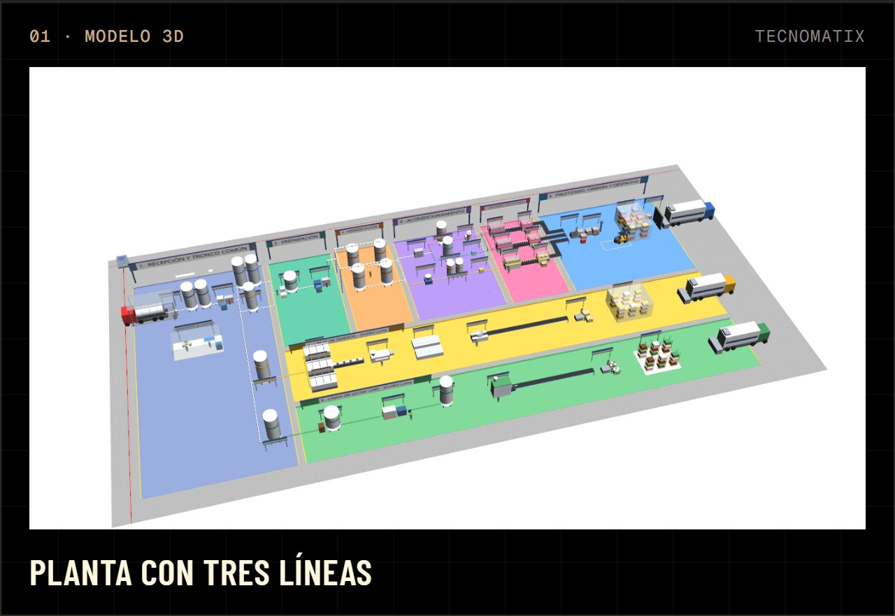
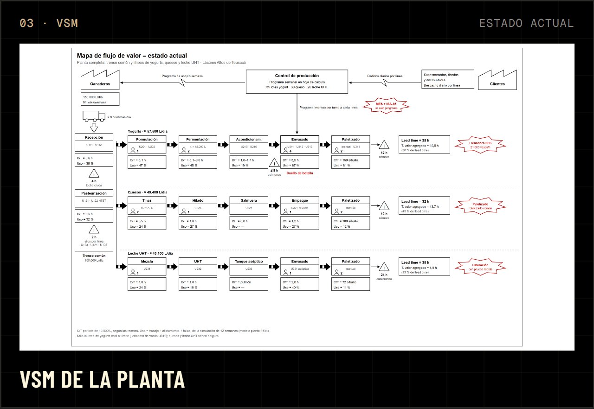
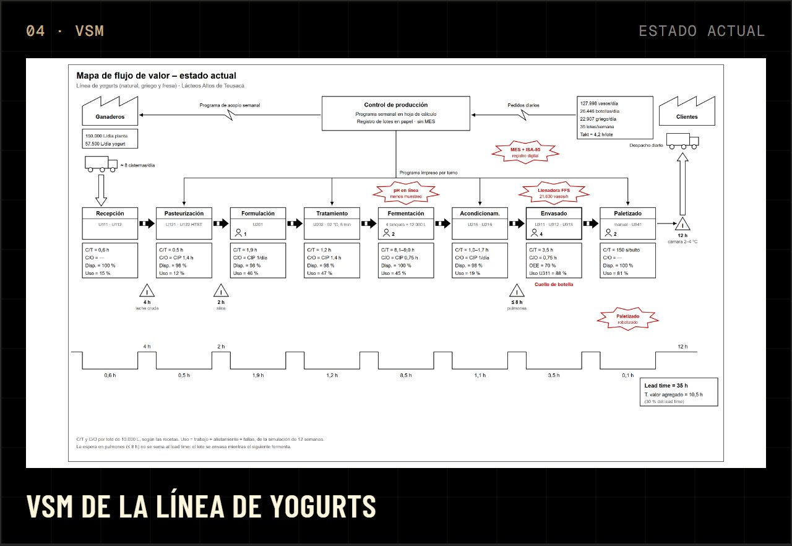
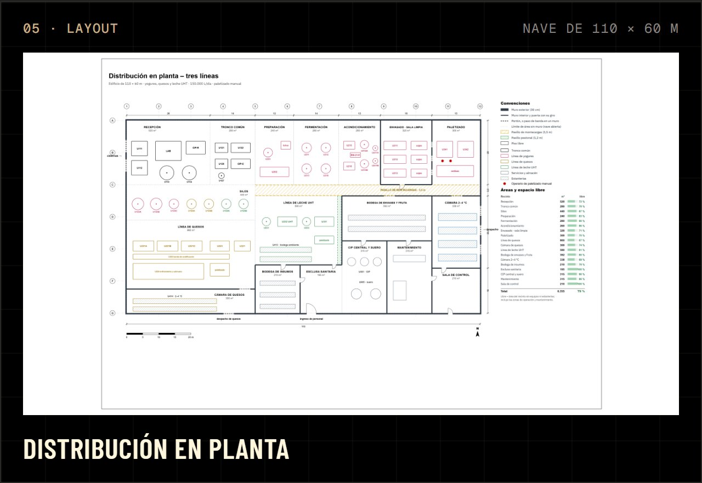
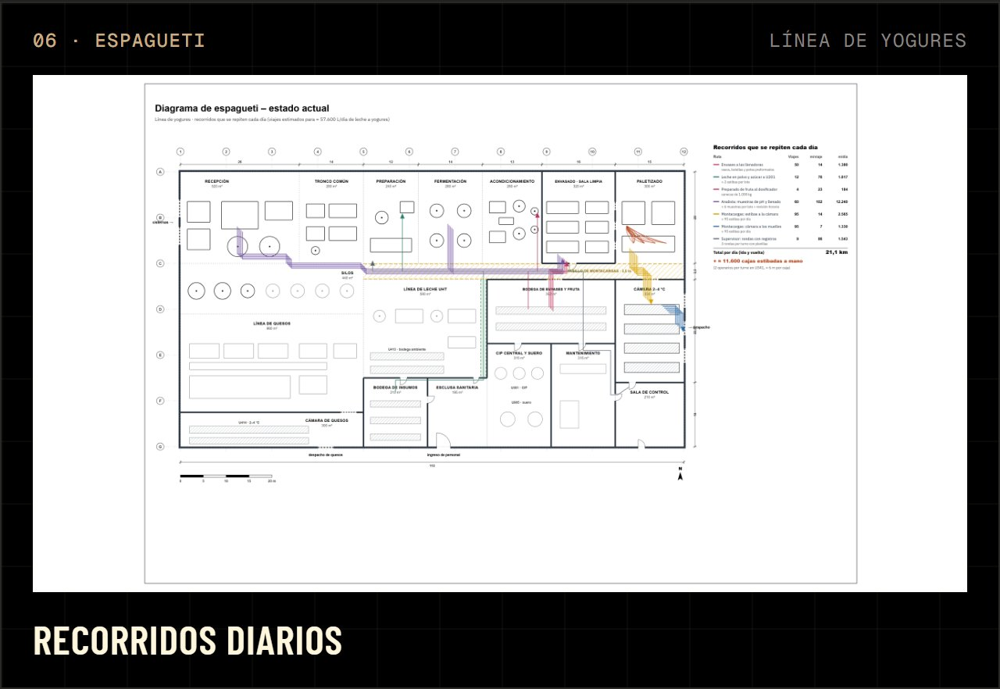
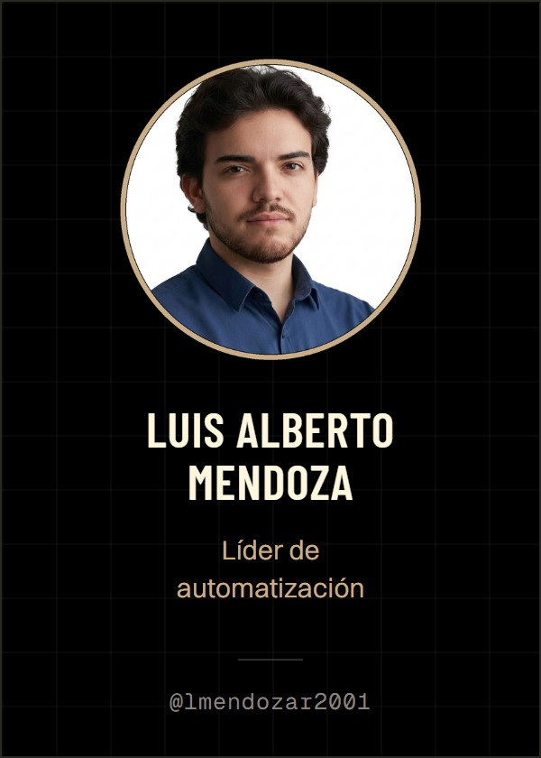
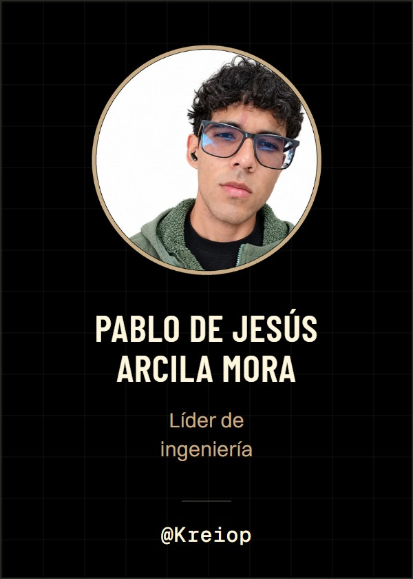
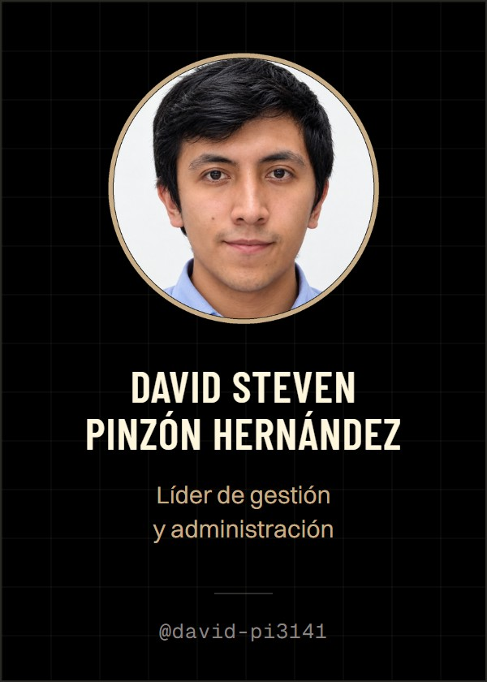
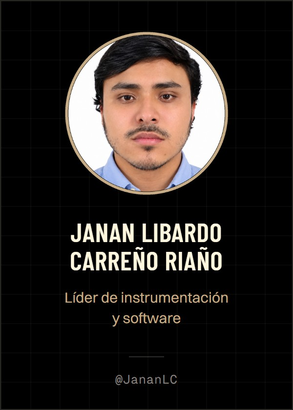

  

  
  
  
  
  
  

  <a href="https://mekvra.github.io/proyecto-integrador/"><b>Página web</b></a>
  &nbsp;·&nbsp;
  <a href="#la-planta">La planta</a>
  &nbsp;·&nbsp;
  <a href="#avances">Avances</a>
  &nbsp;·&nbsp;
  <a href="#equipo">Equipo</a>
  &nbsp;·&nbsp;
  <a href="#estructura">Estructura</a>
  &nbsp;·&nbsp;
  <a href="CONTRIBUTING.md">Cómo aportar</a>

 

  <b>Mekvra S.A.S</b> es una empresa integradora de soluciones de <b>Transformación Digital Industrial</b>, formada por ingenieros mecatrónicos. 
  Conectamos el proceso físico con la gestión del negocio: del sensor en el tanque a la decisión en la gerencia.

Proyecto Integrador · Automatización de Procesos de Manufactura 2026-2S · Universidad Nacional de Colombia · Sede Bogotá

 

<h2 id="la-planta">La planta</h2>

Nuestro cliente es **Lácteos Altos de Teusacá**, una planta de derivados lácteos que recibe **150.000 L de leche al día**. Tres líneas por lotes comparten la recepción, la pasteurización y los silos (acta del 9 de octubre de 2026).

| | Línea | Productos | Alcance en el proyecto |
|:--:|:--|:--|:--|
|  | **Yogures** | Fresa, natural y griego | Línea detallada: recetas ISA-88, simulación, VSM, layout y espagueti |
|  | **Quesos** | Mozzarella, quesillo y doble crema | Recetas básicas y simulación de la planta |
|  | **Leche UHT** | Entera, descremada y con chocolate | Recetas básicas y simulación de la planta |

  

 

<h2 id="avances">Avances</h2>

Estado actual de la planta, antes de la propuesta de automatización. Cada imagen abre el documento completo.

<table>
  <tr>
    <td width="50%" valign="top">
      
      Planta completa en Plant Simulation: tronco común y líneas de yogures, quesos y leche UHT.
    </td>
    <td width="50%" valign="top">
      
      Línea de yogures en seis secciones, de la recepción al despacho, con paletizado manual.
    </td>
  </tr>
  <tr>
    <td width="50%" valign="top">
      
      Mapa de flujo de valor de las tres líneas sobre el tronco común.
    </td>
    <td width="50%" valign="top">
      
      Mapa de flujo de valor de la línea de yogures, de la recepción a la cámara.
    </td>
  </tr>
  <tr>
    <td width="50%" valign="top">
      
      Plano de la nave de 110 × 60 m con las tres líneas. También el <a href="02_gestion-produccion/distribucion-planta/layout_linea_yogures_actual_clasico.pdf">layout de la línea de yogures</a>.
    </td>
    <td width="50%" valign="top">
      
      Recorridos diarios de personas y montacargas en la línea de yogures.
    </td>
  </tr>
</table>

**Recetas ISA-88:** [modelo físico, procedimental y 9 recetas maestras](01_transformacion-digital/isa88) · [recetas de la línea de yogures](01_transformacion-digital/isa88/recetas/Recetas_linea_yogures_v1.8.pdf) · [recetas básicas de la planta](01_transformacion-digital/isa88/recetas/Recetas_basicas_planta_v1.0.pdf)
 
**Planeación:** [EDT](03_planeacion-proyecto/edt-cronograma/EDT_Completo_v1.0.pdf) · [cronograma](03_planeacion-proyecto/edt-cronograma/Cronograma_Planta_Lactea_v1.0.pdf)

Todas las cifras son valores de diseño o de simulación, no medidas en planta.

 

<h2 id="equipo">Equipo</h2>

  
  
  
  
  

 

<h2 id="estructura">Estructura</h2>

El repositorio sigue los módulos del curso. Cada carpeta tiene su propio `README.md` con sus entregables.

| | Módulo | Contenido | Estado |
|:--:|:--|:--|:--:|
| `00` | [**Gestión del equipo**](00_gestion-equipo) | Actas, roles y evidencias de trabajo colaborativo |  |
| `01` | [**Transformación digital**](01_transformacion-digital) | Modelos y recetas ISA-88, arquitectura ISA-95, instrumentación |  |
| `02` | [**Gestión de la producción**](02_gestion-produccion) | Tecnomatix, VSM, layout, espagueti, indicadores, MES/ERP |  |
| `03` | [**Planeación del proyecto**](03_planeacion-proyecto) | EDT, cronograma, presupuesto, flujo de caja, propuesta de valor |  |
| `04` | [**Controladores**](04_controladores) | Grafcet y lógica Ladder en Logix Emulate |  |
| `05` | [**Gemelo digital**](05_gemelo-digital) | Gemelo digital en Siemens NX |  |
| `06` | [**Celda robotizada**](06_celda-robotizada) | Diseño, simulación en RobotStudio y análisis de riesgos |  |
| `07` | [**SCADA**](07_scada) | HMI ISA-101 en Ignition, comunicación OPC |  |
| `08` | [**Investigación**](08_investigacion) | Proceso lácteo, variables de operación y fuentes |  |
| `web` | [**Página web**](web) | Sitio en Astro, publicado automáticamente con GitHub Pages |  |

## Cómo aportar

Sube tus archivos a la carpeta de tu módulo, directamente desde GitHub y sin instalar nada. La guía completa, con las reglas de nombres y cómo editar la página web, está en **[CONTRIBUTING.md](CONTRIBUTING.md)**.

 

  
   
  <b>MEKVRA S.A.S</b>
   
  Automatización e integración industrial · Bogotá, Colombia

